# Welcome

**Ember Studio** is a free, open-source program for making your own Pokémon game. You start from a copy of *Pokémon FireRed (US) v1.1*. From there you change whatever you want: the maps, the people in them, the story, the Pokémon, the trainers, the items, the text, the graphics and the music. The result is a new GBA game that plays on any emulator or flash cart.

You don't need to know programming, hex editing or assembly. Everything is done with forms, a map painter and **blocks**: little coloured cards that you stack to say what happens in the game ("say this", "give a Potion", "walk three steps left").

## What you can do with it

- **Start a new game in a few minutes** with the *New game* wizard. You choose the name, the language (English or Hebrew), the professor, the three starter Pokémon, the town names and the gym leaders.
- **Build maps**: paint blocks, mark where the player can walk, and place people, trainers, items and signs. You can also draw new blocks from any picture.
- **Write a story** as a list of steps: talk to someone, beat a trainer, reach a place, a scene, a yes/no choice, a rival battle. Ember Studio turns the steps into game scripts for you.
- **Change Pokémon** (stats, types, moves, evolutions), **wild encounters**, **trainers and gym leaders**, **items and shops**, and **moves, TMs and tutors**.
- **Translate** all the text, with full right-to-left Hebrew support.
- **Replace graphics**: a new hero or character from a picture, your own title screen, and new map blocks.
- **Play instantly** in the built-in emulator. Start from the beginning, or from any spot on any map with **▶ Play from here**.
- **Check the game** for common mistakes before you share it.

## How this guide is organised

1. **Installing** Ember Studio and starting it.
2. **Your first game** with the wizard.
3. A **tour of the window**.
4. One chapter for each part of the game: maps and the world, objects and blocks, the story, Pokémon, trainers, items, moves, text, graphics and music.
5. **Testing and playing**, the **game check**, and **projects and sharing**.
6. **Troubleshooting**, and the licences.

> **Tip:** The pictures in this guide come from the example game *Ember Quest*, made with the wizard. Your screens will look the same, with your own names and Pokémon.

## Important: the ROM

Ember Studio does **not** include any Nintendo game. You need your own copy of **Pokémon FireRed (US) version 1.1**, as a `.gba` file. The original file is never changed: your project stores only *your changes*. That means you can share a project, or a patch made from it, without sharing the game itself.

# Installing and starting

## What you need

- Windows 10 or 11, 64-bit.
- **Microsoft Edge WebView2**. It is part of Windows 10/11 and is almost always installed already.
- Your FireRed (US) v1.1 ROM.
- About 200 MB of free disk space.

## Installing

Ember Studio is a single file, **`EmberStudio.exe`**, so there is nothing to install. Download it from the project's *Releases* page on GitHub and put it in any folder, for example `Documents\Ember Studio`. Then double-click it.

### The "Windows protected your PC" message

The first time you run it, Windows SmartScreen may show a blue window saying the app is not recognised. This happens with new programs from small open-source projects, not because something is wrong.

1. Click **More info**.
2. Click **Run anyway**.

The EXE is signed, and you can see the certificate in *Properties → Digital Signatures*. Windows only trusts a new signature after many people have downloaded the program. If you prefer, you can also build the EXE yourself from the source code (see *Projects and sharing*).

## What happens on first start

- The editor opens in its own window.
- The built-in emulator (mGBA) is copied once to `%LOCALAPPDATA%\EmberStudio\mgba`.
- Your settings, the language, the autosave and a work folder are kept in `%LOCALAPPDATA%\EmberStudio`. Your projects themselves live wherever you choose, usually in `Documents`.

## Choosing the language

The button at the top right toggles between **English** and **עברית**. The whole interface switches immediately, and in Hebrew the layout runs right-to-left. The language of the *interface* has nothing to do with the language of *your game*: you can make an English game with the Hebrew interface, and the other way round.

## Running from the source code

If you are a developer, or you don't want to run an unsigned EXE:

```
python editor/ember/server.py      # opens the editor in your browser at http://localhost:8765
python editor/ember/app.py         # the same window as the EXE (pip install pywebview pillow)
```

# Your first game: the wizard

The quickest way to start is the **New game** wizard. It asks a few questions and then creates a complete, playable project.

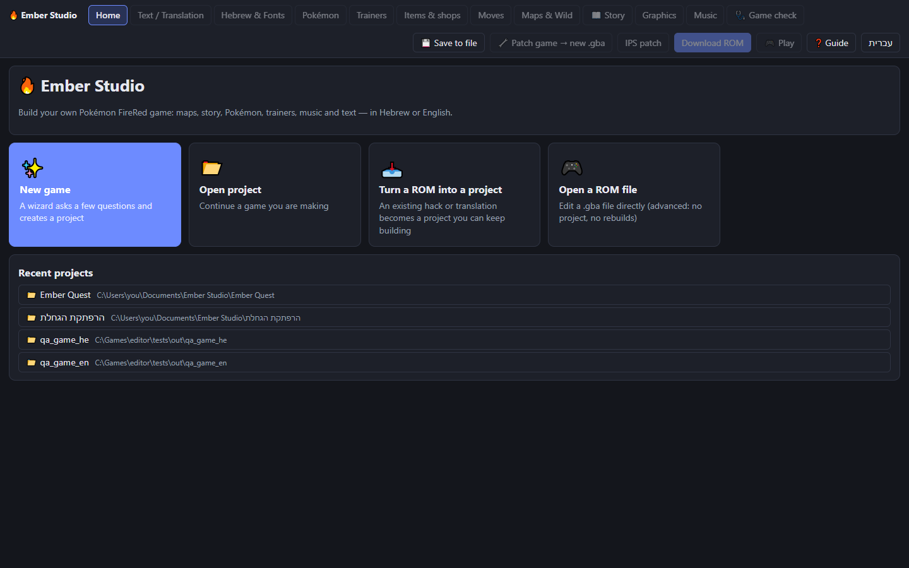

On the home screen you have four choices:

| Button | What it does |
|---|---|
| **✨ New game** | Asks a few questions and creates a project. Start here. |
| **📂 Open project** | Opens a project folder you made before. |
| **📥 Turn a ROM into a project** | Takes an existing hack or translation (a `.gba` file) and turns it into a project, so you can keep working on it. |
| **🎮 Open a ROM file** | Quick editing of a `.gba` file directly, with no project and no building. Good for small fixes. |

Your recent projects are listed below the buttons. Click one to open it.

## Step 1: The basics

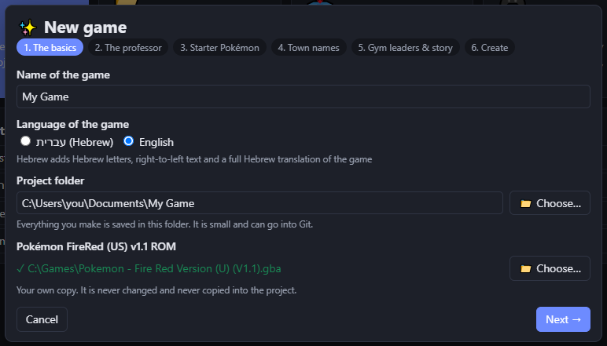

- **Game name**: shown in the title bar and saved in the project. You can change it later.
- **Game language**:
  - **English** keeps the game in English.
  - **עברית (Hebrew)** adds Hebrew letters, right-to-left writing, and a full Hebrew translation of the game.
- **Project folder**: everything you make is saved here. The folder is small (usually less than 1 MB) and is ideal for Git.
- **FireRed ROM**: your own FireRed (US) v1.1 file. Ember Studio checks that it's the right version. The ROM is never changed and never copied into the project.

## Step 2: The professor

Choose the professor's name. All of the professor's lines are updated to use the new name.

## Step 3: Starter Pokémon

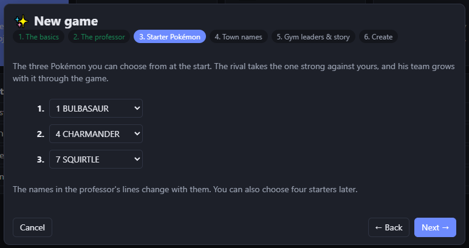

Choose the three Pokémon the player can pick at the start. You can choose any of the first 386 Pokémon. Ember Studio updates everything that depends on the choice:

- the Poké Balls on the professor's table;
- the professor's lines about them;
- the rival's team, which grows with the rival through the game.

## Step 4: Town names

Rename the towns and cities. The new names appear on signs, on the town map, in the "you arrived at…" pop-ups and in all dialogue.

## Step 5: Gym leaders & story

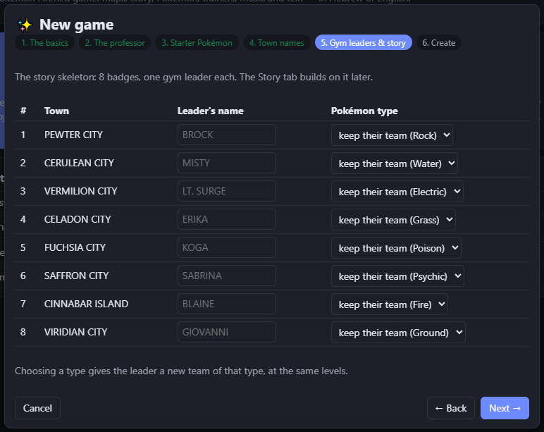

For each of the eight gyms, choose the leader's name and the type of their Pokémon. The leader's whole team changes to Pokémon of that type, at the right levels.

The wizard also starts your **story**: one chapter for each badge, each with a step "Beat the gym leader". You fill in the rest later in the *Story* tab.

## Step 6: Create

Ember Studio creates the project folder and builds the game. You land in the editor with your game open. Press **▶ Play** (or **Build & play**) to try it straight away.

> **Tip:** Every answer in the wizard can be changed later in the editor, so don't worry about getting everything right the first time.

# A tour of the window

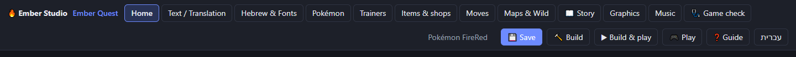

At the top of the window:

- **The title**: Ember Studio and the name of the open project.
- **The tabs**, one for each part of the game:

| Tab | What you edit there |
|---|---|
| **Home** | Open, create or import a project. |
| **Text / Translation** | All the text in the game. |
| **Hebrew & Fonts** | Hebrew letters, the font and right-to-left settings. |
| **Pokémon** | Stats, types, moves, evolutions, starters and gift Pokémon. |
| **Trainers** | Every trainer and gym leader and their teams. |
| **Items & shops** | Items, prices, descriptions and what every shop sells. |
| **Moves** | Moves, TMs and HMs, and move tutors. |
| **Maps & Wild** | The map editor, the world view, wild Pokémon, and blocks & tiles. |
| **📖 Story** | The storyline, step by step. |
| **Graphics** | Pokémon pictures, characters from a picture, and the title screen. |
| **Music** | Which song plays where, and importing music. |
| **🩺 Game check** | Looks for problems in the whole game. |

- **The project buttons**:
  - **💾 Save** writes your changes to the project folder. Ember Studio also autosaves while you work, so you won't lose much if something goes wrong.
  - **🔨 Build** makes the final game file, `out/game.gba`.
  - **▶ Build & play** builds, then opens the game in the emulator.
  - **🎮 Play** plays the game as it is right now, without building.
  - **English / עברית** switches the interface language.

## Saving and building, in short

- **Saving** stores *your changes*: a small patch file and a few readable JSON files.
- **Building** applies those changes to your original ROM and writes a complete game to `out/game.gba`.
- You can save as often as you like. You only need to build when you want the final file: to share it, or to play it in another emulator.

# Maps

The **Maps & Wild** tab has three views at the top: **Map editor**, **World view** (all connected maps together) and **Blocks & tiles**.

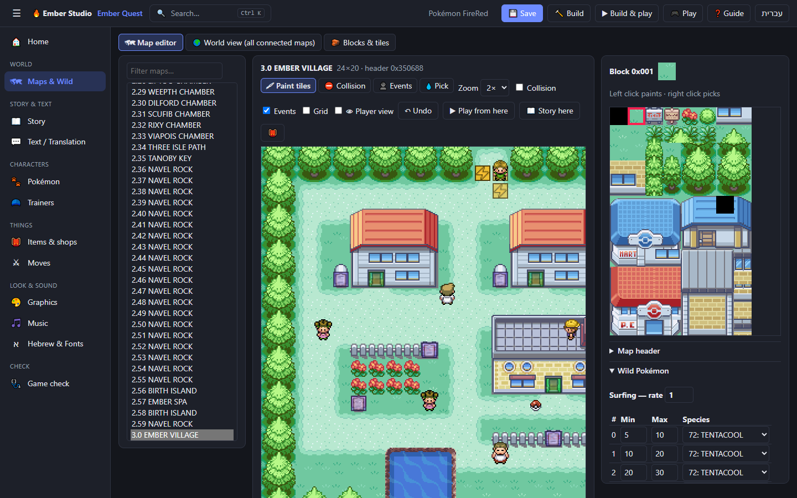

## Finding a map

The list on the side shows every map in the game, by number and name, for example *3.0 Pallet Town*. Type in the box above the list to filter it. The numbers are *group.map*: group 3 is the outdoor towns and routes, and the other groups are mostly buildings and caves.

## Painting

1. Choose **🖌 Paint tiles**.
2. Click a block in the block picker on the side.
3. Click or drag on the map to paint with it.

Some useful shortcuts:

- **Right-click** a block on the map to pick it up as your brush.
- **Zoom** with the zoom menu (×1 to ×4).
- **Undo** with the ↶ button or <kbd>Ctrl</kbd>+<kbd>Z</kbd>.
- **💧 Pick** takes a block from the map, like right-click.

The **Collision**, **Events** and **Grid** checkboxes show or hide those layers over the map.

## Collision: where the player can walk

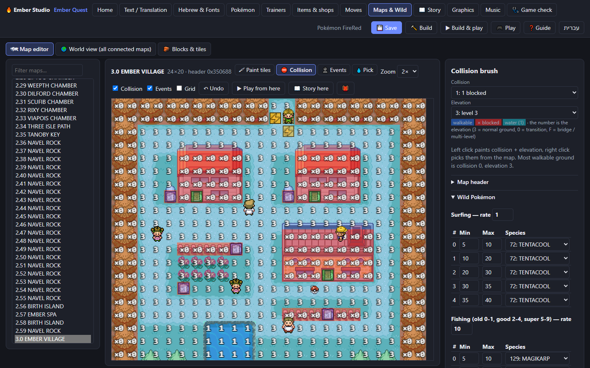

In **⛔ Collision** mode every square shows whether the player can walk on it:

- **Free**: the player can walk here.
- **Blocked**: walls, trees and the edges of buildings.
- **Elevation**: for bridges and ledges.

Choose a brush from the *Collision brush* panel and paint over the map. If the player walks through walls or gets stuck on an empty floor, the collision is wrong. Fix it here.

## Objects

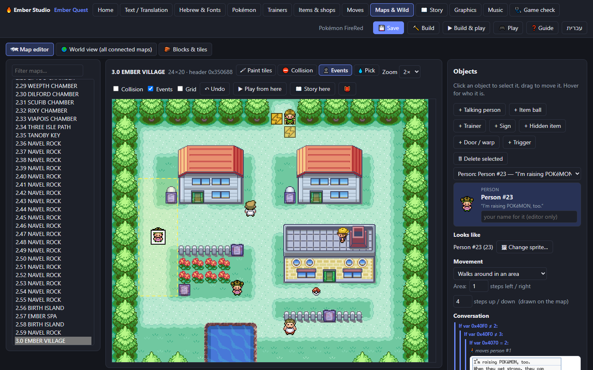

In **👤 Events** mode you see everything that *does* something on the map:

- **People**: anyone the player can talk to. They can stand still, look around or walk in an area.
- **Trainers**: people who battle the player when they see them.
- **Item balls**: Poké Balls on the ground with an item inside.
- **Signs**: text that appears when the player reads the sign.
- **Hidden items**: items hidden on a square, found by pressing A there.
- **Triggers**: invisible squares that start a script when the player steps on them.
- **Doors and warps**: where the player goes to another map.

Some useful actions:

- **Add an object** with the buttons in the side panel (**+ Talking person**, **+ Item ball**, **+ Trainer**, **+ Sign**, **+ Hidden item**, **+ Door / warp**, **+ Trigger**). Then click on the map to place it.
- **🗑 Delete selected** removes the selected object.
- **Move an object** by dragging it.
- **Select an object** by clicking it. Its settings open in the side panel.
- Hover over an object to see who it is and what it says.

The next chapter goes into objects in detail.

## Map settings

Under **Map settings** in the side panel you can change the map's name (as shown in the game), its music, its **weather** and its **map type** (town, route, indoors, cave…).

## ▶ Play from here

The **▶ Play from here** button lets you test any spot in the game:

1. Press **▶ Play from here**. The cursor becomes a crosshair.
2. Click any square on the map.
3. The game starts *right there*, with a test team, so you can walk around and talk to people at once.

This is the fastest way to check a change. The test team can be changed with the 🎒 button.

# The world view

The **World view** shows all the maps that connect to each other, laid out the way they are in the game. Here you can see the shape of your region, move maps relative to each other, and paint across map edges.

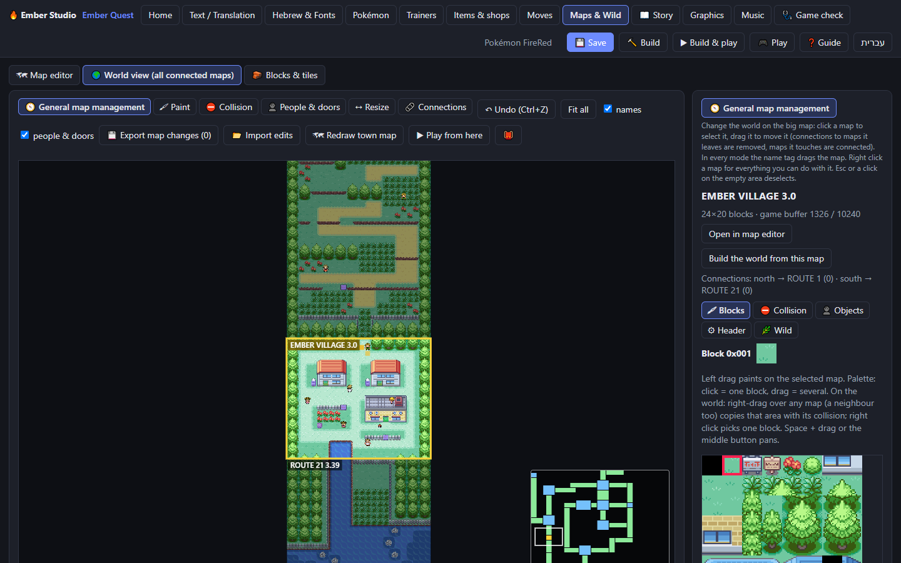

## What you can do here

- **Navigate**: drag with the mouse to move around, and use the mouse wheel to zoom. The mini-map in the corner shows where you are.
- **🧭 General map management** (the first mode, and a button at the top of the side panel): click a map to select it, and drag it to move it anywhere. Connections to maps it moves away from are removed, and maps it touches after the move are connected. Ctrl+Z undoes it. A map that ends up connected to nothing stays where you put it, marked *not connected*.
- **The name tag** in the corner of every map moves the map when you drag it, in every mode, even while painting.
- **Deselect** with Esc, a click on the empty area (in management mode), or *Deselect* in the right-click menu.
- **Right click on a map** opens a menu with everything you can do with it: select or deselect, paint, collision, people & doors, resize, connections, pick the block under the mouse, play from here, open in the map editor, build the world from this map, and delete the map. Dragging with the right button still copies blocks.
- **Select a map** by clicking it. The side panel shows its name, size and connections, plus buttons to open it in the map editor.
- **✏ Paint** on any map, exactly as in the map editor. Painting works across the edges between maps.
- **↔ Resize: drag an edge**: a thick yellow frame appears around the map. Drag an edge or a corner to make the map bigger or smaller, like a window.
- **🗑 Delete map** (right-click menu) removes all the map's connections, and the map leaves the world. It also leaves the game's map list only when it is the last map of its group and no door leads to it (for example a map you just made). Otherwise it stays in the list, because removing it from the middle would renumber the maps after it and break their doors. The question before deleting says which maps have doors to it.
- **🔗 Connections** shows and edits which maps lead to which.
- **🗺 Redraw town map** redraws the town map (the region map in the game) so that it follows your world.
- **💾 Export map changes** and **📂 Import edits** save your world edits to a file (`world_edits.json`) and load them into another copy of the game.

If two maps overlap, or their connections disagree, a warning appears above the map. Fix it before you share the game.

## Going through doors

In **👤 People & doors** you can follow a door to the map it leads to, and come back:

- **Right click on a door** and choose *🚪 Go through the door to …*, or **double-click the door**.
- If the map behind the door is already in the world (for example a cave that comes out on another route), the view jumps to it. Otherwise the view shows that map on its own (for example the inside of a house).
- The door you arrive at is selected and centred, with its panel open on the side.
- **↩ Back to …** (in the right-click menu and as a button in the toolbar) goes back one step, to the map you came from, with the door you left by selected.
- After going several steps in (town → house → upstairs), **🌍 Back to the world map** goes all the way back.
- Some doors send the player back to wherever they came from (the game decides). They lead to no fixed map, so they cannot be followed.

## ▶ Play from here (world view)

It works the same way as in the map editor:

1. Click a map to select it. The **▶ Play from here** button changes from grey to active.
2. Press the button.
3. Click a spot on the map. The game starts there.

## Wild Pokémon

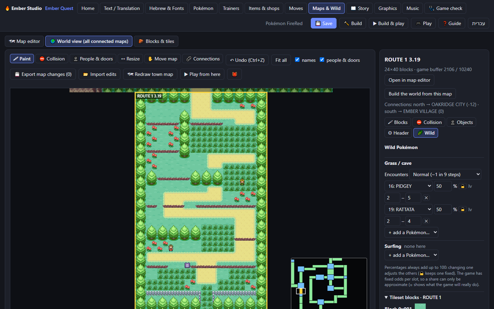

Choose a map and open the **🌿 Wild** tab in the side panel. For each kind of encounter (*grass / cave*, *surfing*, *fishing*, *rock smash*) you can:

- choose **how often** encounters happen (rare, normal, often…);
- add Pokémon with **+ add a Pokémon…**;
- set the **level range** of each Pokémon;
- set each one's **chance** in percent. The chances always add up to 100. Change one, and the others adjust. The 🔒 lock keeps a value fixed.

The real game picks encounters from fixed slots. The chances shown are therefore rounded to the nearest possible values (≈).

# Blocks and tiles

Maps are made of **blocks** of 16×16 pixels. Each block is made of four 8×8 **tiles**. The blocks of a map come from its **tileset**: the town tileset, the cave tileset and so on.

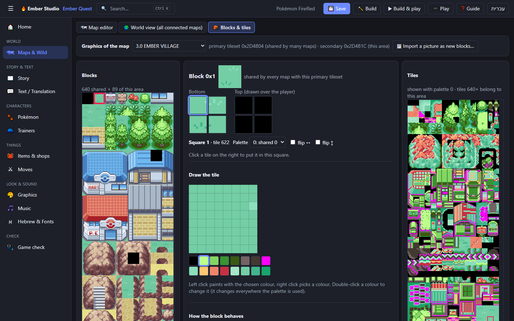

In **Blocks & tiles** you can:

- see all the blocks of the current map's tileset;
- change what each block looks like, and whether it is walkable;
- **import a picture as new blocks**.

## Importing a picture as new blocks

This is the easy way to add something new to your maps, such as a statue, a flag, a building or a sign.

1. Draw or find a picture. Width and height should be multiples of 16 pixels, for example 32×48.
2. Click **Import a picture as new blocks** and choose the file.
3. Ember Studio cuts the picture into blocks, matches the colours to the tileset's palette, and adds the blocks to the tileset.
4. Go back to the map editor and paint with the new blocks.

> **Tip:** Pictures with few colours and clear outlines look best. Every tileset has a limited number of colours, and Ember Studio chooses the closest ones it has.

# Objects in depth

Click an object in **👤 Events** mode to open its settings.

## People

- **Looks like**: the sprite. Click **🖼 Change sprite…** to choose from all the characters in the game.
- **Movement**: stands still, looks around, walks in an area, or walks up and down.
- **Script**: what happens when the player talks to them. See *Blocks* below.
- **Name**: a note for you, shown only in the editor.

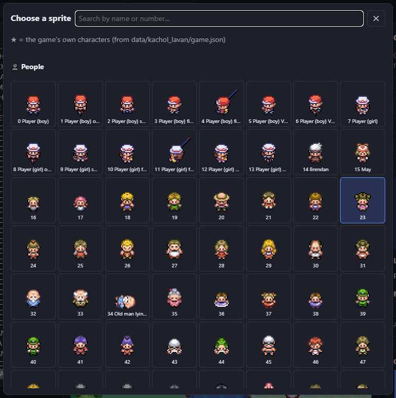

## Trainers

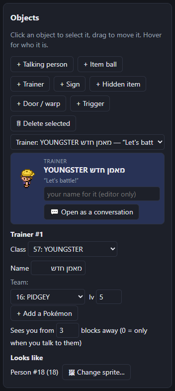

A trainer is a person who battles the player when they meet:

- **Trainer**: which trainer from the *Trainers* tab. That decides the team, the class and the picture.
- **Sight range**: how many squares away they notice the player.
- **Intro text and defeat text**: what they say before and after the battle.
- **Open in the Trainers tab**: jumps to their team.

## Item balls

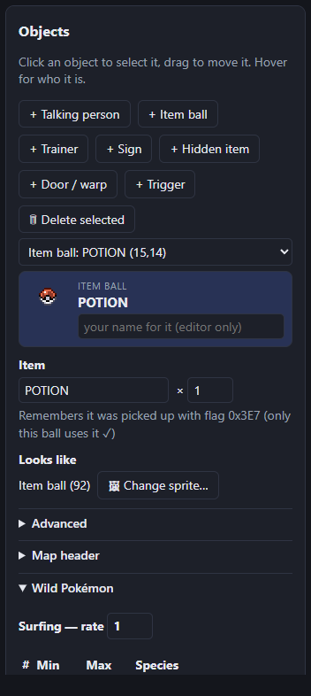

- **Item**: what the player gets.
- **Flag**: remembers that the ball was picked up, so it doesn't come back. Ember Studio chooses a free flag for new balls automatically.

## Signs and triggers

- **Signs** show text when the player faces them and presses A.
- **Triggers** are invisible squares that start a script when the player steps on them. They are used for scenes like "the professor stops you at the edge of town". Most of the time you will make triggers through the *Story* tab, which does it for you.

# Blocks

A **script** is what happens when the player talks to someone, reads a sign or steps on a trigger. In Ember Studio you write scripts with **blocks**. You stack them from top to bottom, and the game runs them in that order.

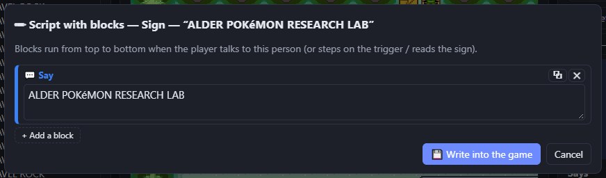

To edit a script:

1. Click **Write it with blocks** (or **Edit the blocks**) on a person, sign or trigger.
2. Click **+ Add a block** to choose a block.
3. Fill in its fields.
4. Drag blocks to change their order. **⧉** copies a block and **✕** deletes it.
5. Press **💾 Write to the game**.

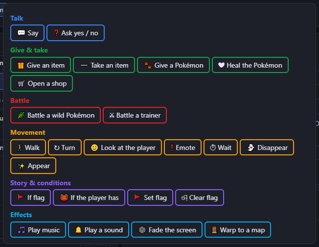

## All the blocks

| Group | Block | What it does |
|---|---|---|
| **Talk** | 💬 Say | Shows a message. Press Enter in the text for a new line. |
| | ❓ Ask yes / no | Asks a question. You put different blocks under *yes* and under *no*. |
| **Give & take** | 🎁 Give an item | Gives the player an item (and a quantity). |
| | ➖ Take an item | Takes an item away. |
| | 🐾 Give a Pokémon | Gives a Pokémon at a level, with an optional message. |
| | ❤ Heal the Pokémon | Heals the whole team, like a Pokémon Center. |
| | 🛒 Open a shop | Opens a shop with the items you choose. |
| **Battle** | 🌿 Battle a wild Pokémon | Starts a battle with a wild Pokémon. |
| | ⚔ Battle a trainer | Battles a trainer, with intro and defeat text. |
| **Movement** | 🚶 Walk | Moves the player or a person, step by step, at normal, slow or fast speed. |
| | ↻ Turn | Turns someone in a direction. |
| | 🙂 Look at the player | The person turns to face the player. |
| | ❗ Emote | Shows ❗, ❓ or ♥ above someone's head. |
| | ⏱ Wait | Waits a number of seconds. |
| | 👻 Disappear / ✨ Appear | Hides or shows a person. This is remembered. |
| **Story & conditions** | 🚩 If flag | Runs different blocks depending on a flag. |
| | 🎒 If the player has | Runs different blocks depending on whether the player has an item. |
| | 🚩 Set flag / 🏳 Clear flag | Remembers (or forgets) that something happened. |
| **Effects** | 🎵 Play music | Changes the music. |
| | 🔔 Play a sound | Plays a sound effect. |
| | 🌑 Fade the screen | Fades to black, or back in. |
| | 🚪 Warp to a map | Sends the player to another map. |

> **What is a flag?** A flag is an on/off switch that the game remembers in the save file. For example "the player already got the Potion from Mom". With flags, people say something new the second time you talk to them, and items don't come back. The *Story* tab takes care of most flags for you.

## Picking places and people

Fields like *who walks*, *who* or *where* have a **👆 Pick on the map** button (*Pick the person on the map*, *Pick the spot on the map*). Click it, then click on the map. You never need to type coordinates.

## Preview

In the *Story* tab, **▶ Play the preview** shows a quick animation of the walking and messages in a scene, right in the editor. It's a sketch: the real result is in the game. Use **▶ Play from here** or **Test from this step** to see that.

# The story

The **📖 Story** tab is where you write the plot of your game: what the player must do, in what order, and what people say along the way. You don't write scripts and flags by hand. You make a list of **steps**, and Ember Studio builds everything else.

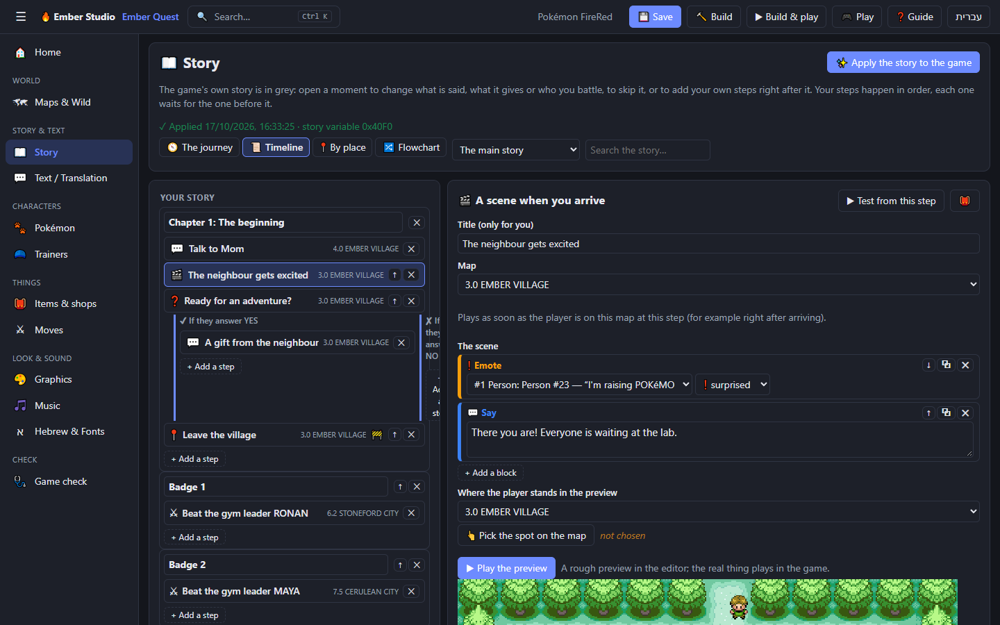

## How it works

- The story is a list of **chapters** (on the side). Each chapter is a list of **steps**.
- Steps happen **in order**. Each step opens the next one.
- The game remembers how far the player got in one number, the **story stage**. You don't need to manage it, but you can see which variable it uses at the top of the tab.

Click a step to edit it. Its settings open on the right.

## Kinds of steps

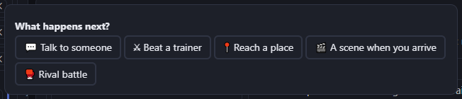

| Step | What happens |
|---|---|
| 💬 **Talk to someone** | The player talks to a person, and the blocks you write run. Example: "Mom gives you running shoes". |
| ⚔ **Beat a trainer** | The player must beat a trainer or gym leader. You can add blocks that run right after the win. |
| 📍 **Reach a place** | Something happens when the player steps on a spot. Example: the professor stops you at the edge of town. |
| 🎬 **A scene when you arrive** | A scene runs as soon as the player arrives on a map, for example a cutscene in a new town. |
| ❓ **A choice (yes / no)** | Someone asks a question, and the story splits into two paths. |
| 🥊 **Rival battle** | A battle with your rival, whose team depends on the starter the player chose. |

## Writing a step

For most steps you fill in:

1. **Title (only for you)**: a short name that appears in the list.
2. **Who** or **Where**: the person, or the map and spot. Use **👆 Pick on the map**.
3. **What happens**: blocks, exactly like in the blocks editor.

Each step has a **Test from this step** button (▶). It starts the game right before that step, with the story stage already set. You see exactly what a player sees at that point, without playing the whole game up to it.

## Choices and endings

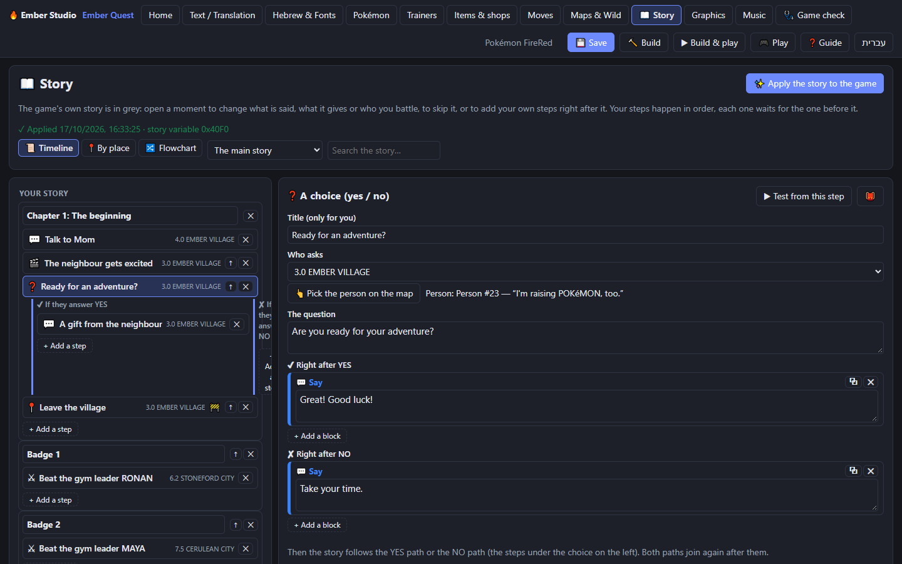

A **choice** step asks a yes/no question. Under it there are two columns:

- **✔ If they answer yes** has its own steps.
- **✘ If they answer no** has different steps.

Each path can have its own steps, its own scenes and even its own ending. After the paths, the story continues together.

## Roadblocks (guards)

Often the player must not go somewhere yet: "You can't leave town without a Pokémon!". In a **Reach a place** step or a **Talk** step you can add a **guard**: a person who stands in the way until the step is done, and then disappears. Ember Studio takes care of hiding them at the right moment.

## Characters who change over time

Under **Characters: lines that change with the story**, a person can say different lines at different points in the story. For example, a villager says "I heard about a strange Pokémon…" at the start, and "You beat the gym leader!" after the first badge. You add a line and choose **after "…"**, the step after which it starts.

## Applying the story

Press **✨ Apply the story to the game**. Ember Studio writes all the scripts, triggers and scenes into the game. You can change the story and apply it again at any time: the old version is removed first, so nothing is left behind.

> **Tip:** Work in small pieces. Write one or two steps, apply, and try them with **Test from this step**.

## The game's own story

The Story tab also shows the story that is **already in the game**: Oak stopping you at the tall grass, choosing your first Pokémon, the rival battle, the parcel, every gym leader, Team Rocket, the Elite Four… Ember Studio finds it by following every script in the game, so it works for FireRed and for hacks built on it. FireRed's own moments have proper names. In a hack, whatever still matches keeps its name, and anything new is named after what it does.

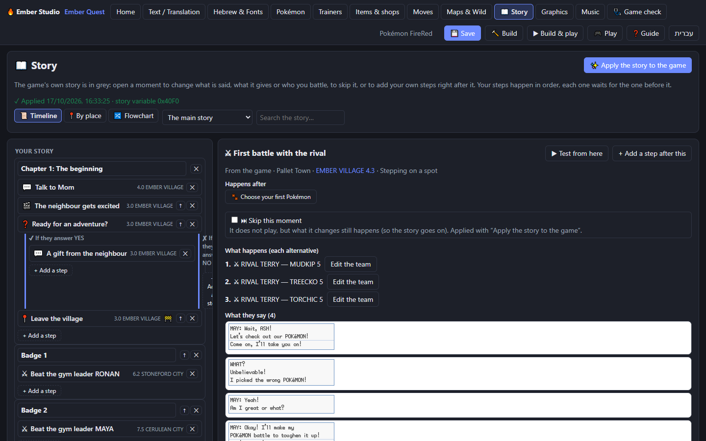

The moments of the game are the grey cards under **The story of the game**, in chapters by place: Pallet Town, Viridian City, Pewter City and so on. Your own steps are in colour.

### Three ways to look at it

The buttons at the top switch between three views:

- **📜 Timeline**: the whole story, chapter by chapter, in the order of the game.
- **📍 By place**: one map at a time, with everything that happens there in order. For example, in Oak's lab: arriving, choosing a Pokémon, the rival battle, then the parcel and the Pokédex. In the map editor, **📖 Story here** opens this view for the map you are on.
- **🔀 Flowchart**: boxes and arrows. An arrow means "this has to happen first".

The menu next to them switches between **The main story** and **Everything that happens**, which adds side events such as gifts, fishing rods and Team Rocket grunts. The search box finds a moment by name or by place.

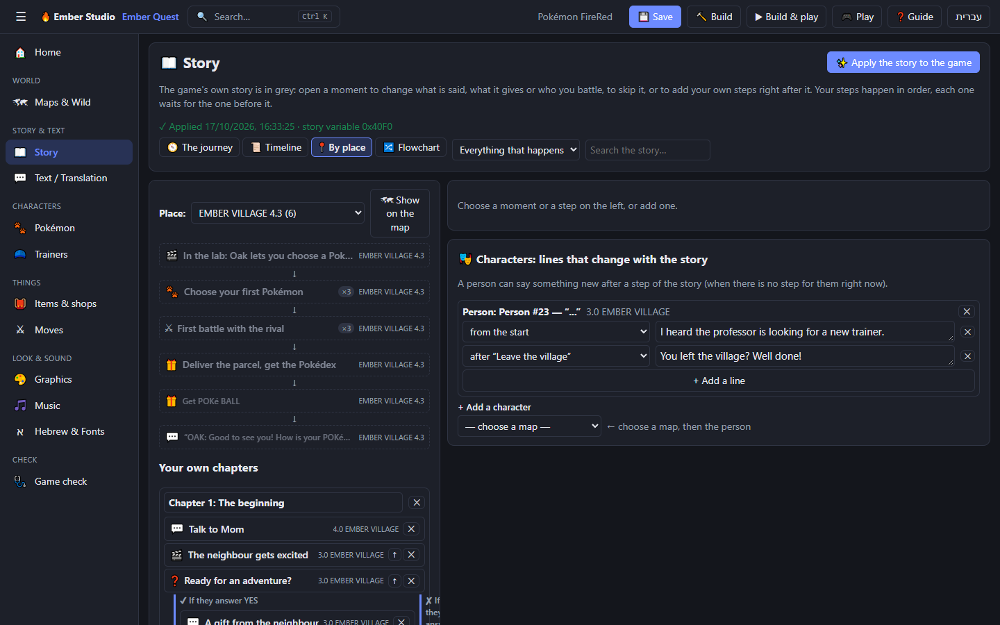

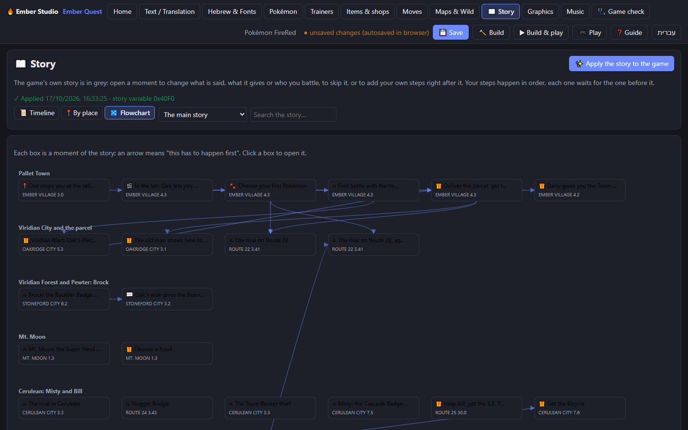

### Changing a moment

Click a moment to open it on the right:

- **Happens after**: the moments that have to come first. Click one to jump to it.
- **What happens**: the Pokémon or item it gives, and the battle. You can change the Pokémon, its level, the item and how many. **Edit the team** opens the trainer in the Trainers tab. When a moment has alternatives, each one is listed: one per starter, or a different rival team for each starter.
- **What they say**: every line of the moment. Click a line to edit it; the preview shows the message box.
- **▶ Test from here**: starts the game on a spot you choose, with the flags and variables set as they are right before this moment.
- **How the game decides** (closed by default): the flags and variables behind it, for those who want to know.

Changes to lines, Pokémon, items and teams go straight into the game, like any other edit.

### Skipping a moment

Tick **⏭ Skip this moment** to cut a moment out, for example "Oak stops you at the tall grass". It no longer plays, but what it changes still happens, so the rest of the story does not get stuck. Its gifts are given quietly. The skip goes into the game when you press **✨ Apply the story to the game**, and you can untick it at any time.

### Your steps between two moments

The **+** next to a moment (or **+ Add a step after this**) starts a chapter of your own right after it. Use it for something like a new scene between choosing the starter and the rival battle:

1. Click **+** next to **Choose your first Pokémon**.
2. Add your steps, exactly as in your other chapters.
3. Under the chapter's title, choose which moment of the game waits for it: by default the next one, here **First battle with the rival**. Or choose *the game goes on as usual*.
4. Press **✨ Apply the story to the game**.

Now the rival battle does not start until your steps are done. Each such chapter has its own story variable, so a chapter after the rival does not wait for one after Brock.

> **Tip:** Undo is exact. Untick a skip or delete your chapter, put the story into the game again, and the game's scripts are back byte for byte.

# Pokémon

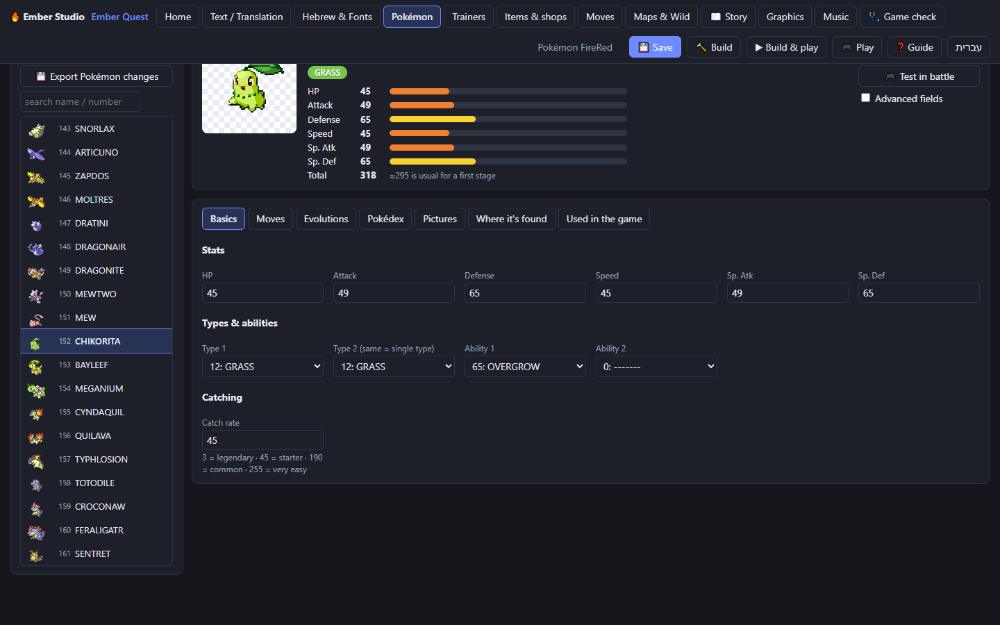

Choose a Pokémon from the list (you can search by name or number). You can change:

- **Base stats**: HP, Attack, Defense, Speed, Sp. Atk and Sp. Def. The total is shown.
- **Types and abilities.**
- **Catch rate, experience, gender ratio** and egg groups.
- **Evolutions**: at what level, with which stone, or by trade.
- **Learnset**: which moves it learns at each level.
- **TM/HM compatibility**: which TMs it can learn.
- **The Pokédex entry.**

## Starters, gift Pokémon and fixed battles

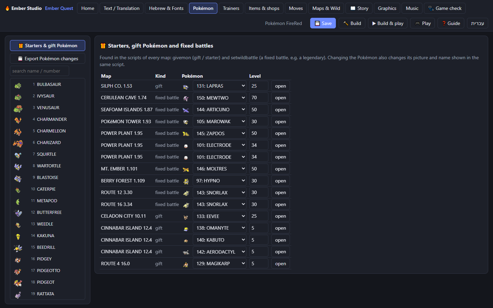

**🎁 Starters & gift Pokémon** lists every place in the game where the player gets a Pokémon or meets a fixed one:

- the starters;
- gifts, like the Lapras in Silph Co.;
- fixed battles, like Snorlax or the legendary birds.

Change the Pokémon or the level, and Ember Studio changes the script and the picture shown with it.

**💾 Export Pokémon changes** saves your Pokémon edits as a file you can share or import into another project.

# Trainers

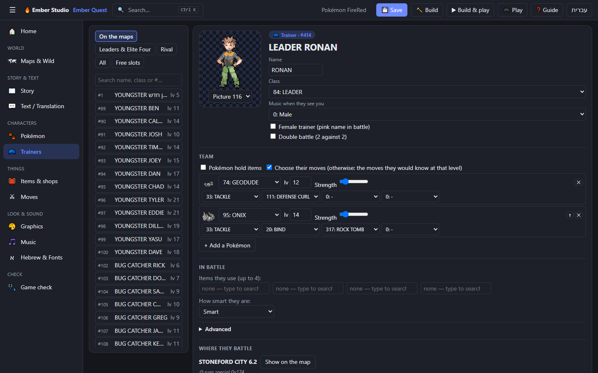

On the left is the list of all trainers. You can filter it to show only **gym leaders and rivals**, by **map**, or by **class**. For each trainer you can change:

- **Name** and **class** (Youngster, Lass, Leader…), plus the **music** played when they spot you.
- **Picture**: the trainer's battle picture.
- **Double battle**: battle with two Pokémon at once.
- **Team**: up to six Pokémon, each with a level, and, if you want, its own moves and held item.
- **Items** the trainer uses in battle (up to four), and **how smart** they are.

## Difficulty along the story

The **📈 Difficulty along the story** chart shows every trainer as a point: how strong their strongest Pokémon is, from the start of the game to the end. Gym leaders are gold, rivals are blue, and trainers who are much stronger or weaker than the trainers around them are red.

- Click a point to open that trainer.
- **Fit them to the curve** fixes the trainers that stand out.
- **All trainers on the map… %** makes all the trainers of a map stronger or weaker by a percentage.

# Items and shops

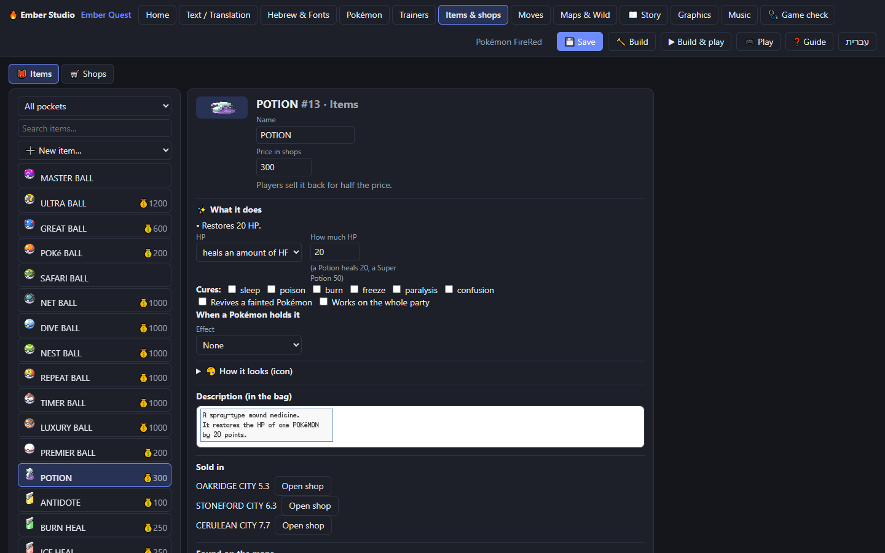

For each item:

- **Name**, **price** and **description**, where it is sold and where it lies on the maps.
- **Pocket** (items, key items, Poké Balls, TMs, berries).

## ✨ What it does

At the top of the card, a few short sentences say what the item does, for example *Restores 20 HP* or *Catch chance ×2*. Below them are fields for what you can change:

- **Poké Balls:** the catch bonus of the Ultra, Great, Poké and Safari Balls (×2 = twice as easy as a Poké Ball). The rules of the special balls (Net, Nest, Timer…) are part of the game's code: they are explained but not editable.
- **Medicine:** how much HP it heals (an amount, all, or half), which status problems it cures (sleep, poison, burn, freeze, paralysis, confusion), whether it revives a fainted Pokémon, whether it works on the whole party, how much PP it restores, and the effort points of vitamins.
- **Battle items** (X Attack and the like): how many stages each stat goes up.
- **Evolution stones:** the list of Pokémon that evolve with the stone. Add a new pair (from → into) or remove one.
- **Repels:** for how many steps they work.
- **When a Pokémon holds it:** the effect chosen from a list in words (for example *Restores HP every turn* or *Boosts Fire moves*), its strength with a label that says what the number means, and an explanation.

The raw numbers are still under **Advanced**.

## 🎨 How it looks

Open **How it looks (icon)** to draw the 24×24 icon:

- a pixel editor with a pen, fill, colour picker and undo;
- double-click a colour to change it, and the whole icon changes with it (colour 0 is transparent);
- **🖼 Import a picture…** fits a picture into 24×24 with 15 colours of its own;
- **Copy the icon of another item** starts from an existing icon;
- **💾 Save icon** saves it. Icons are often shared between items: saving gives this item a copy of its own, so the others do not change.

## ➕ New items

**➕ New item…** at the top of the list makes a new item in one of the game's unused slots (named *????????*). Choose what it is like: heals HP (like Potion), cures status, revives, restores PP, raises a stat for good, raises a stat in battle, an evolution stone, a held item, a repel, or something to sell. The new item copies that item's behaviour, effect and icon. Then give it a name, an icon and a description, and put it in a shop or on a map.

New Poké Balls and new berries are not possible: the game recognises them by their number.

## Shops

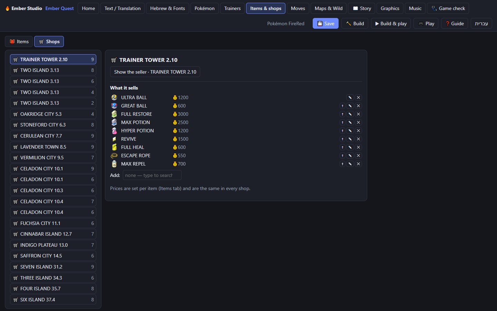

The **Shops** view lists every shop in the game: each Poké Mart counter and each special shop. Choose one to change what it sells, add or remove items, and change the order.

You can also create a new shop anywhere with the **🛒 Open a shop** block.

# Moves

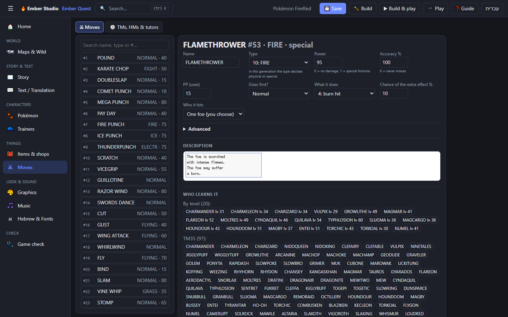

For each move:

- **Name** and **description**.
- **Type**, **power**, **accuracy** and **PP**.
- **Category**: physical or special (as in FireRed, decided by the type).
- **Effect** and its chance, plus **priority**.

## TMs, HMs and move tutors

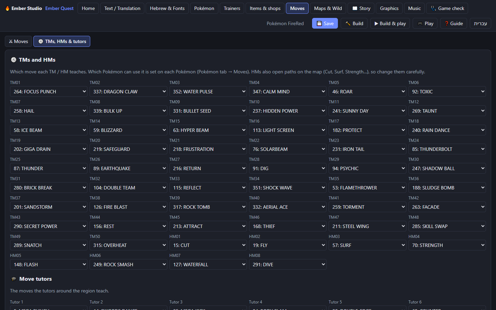

- **TMs and HMs**: which move each TM teaches. The TM's name and description follow the move.
- **Move tutors**: which move each tutor in the game teaches.

Which Pokémon can learn each TM is set in the *Pokémon* tab.

# Text and translation

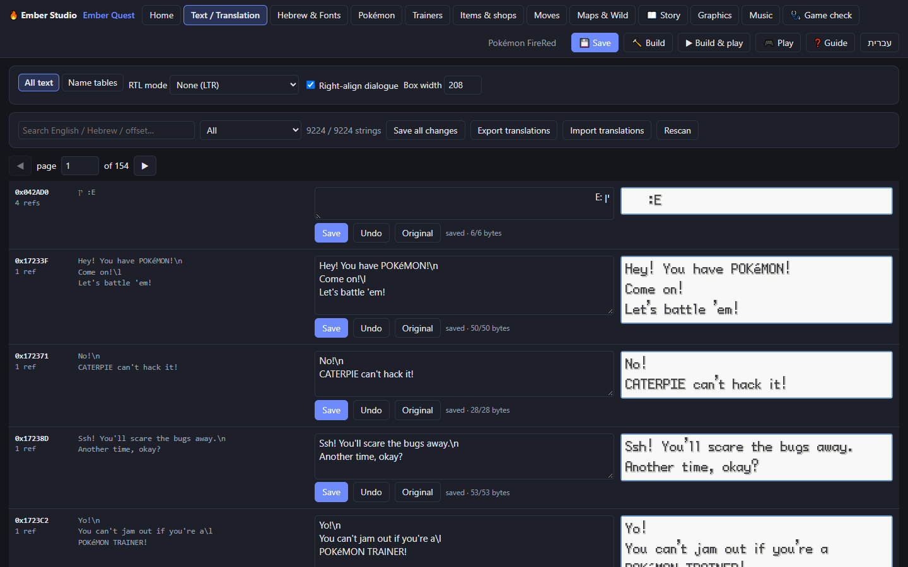

The **Text / Translation** tab shows every piece of text in the game: dialogue, signs, menus and names. More than 9,000 strings.

- **Search** in English (the original) or in your translation.
- **Filter** to show only untranslated, translated or changed lines.
- **Type the new text** in the box. The preview on the left shows exactly how it will look in the game's message box, line by line.
- **Save** each line, or **Save all changes** at once.
- **Export translations** and **Import translations** move all the text to and from a file, so you can translate in another program or with friends.

## The built-in Hebrew translation

Ember Studio comes with a full Hebrew translation of FireRed (more than 7,000 lines). It does not contain the original English text, which belongs to Nintendo: each line carries only a short fingerprint (a hash) of the English line, and Ember Studio compares it with the text in your own ROM. A line that does not match your ROM is skipped.

## Line width

A line that is too wide for the message box is shown in red. Break it with a new line, or make it shorter. The *Game check* also finds these lines.

# Hebrew and fonts

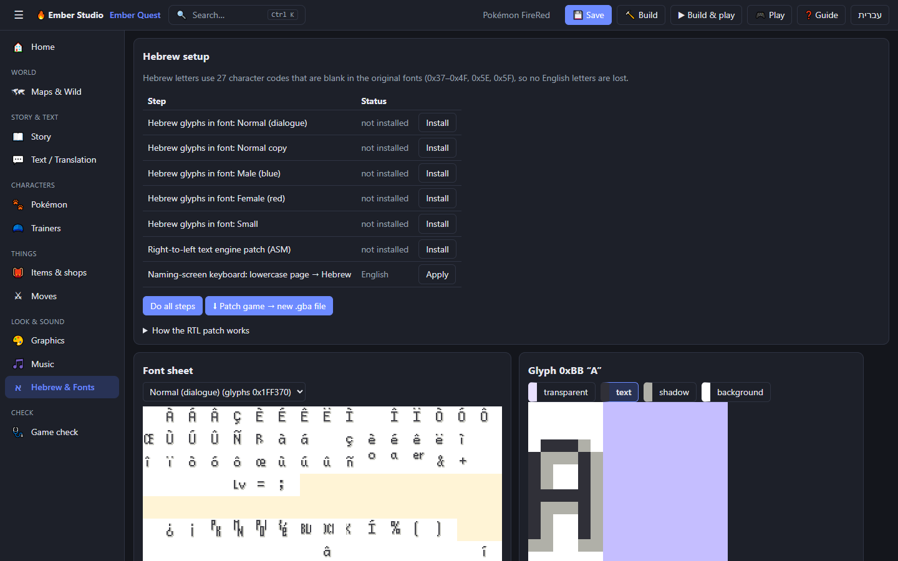

When the game language is Hebrew, Ember Studio:

- adds **Hebrew letters** to the game's font;
- patches the game to write **right-to-left**, including mixed lines with numbers and English names;
- can apply a **complete Hebrew translation** of the original game, which you can then change.

The **font sheet** shows all the letters. You can redraw any letter pixel by pixel, for example to make the Hebrew letters match your style.

# Graphics

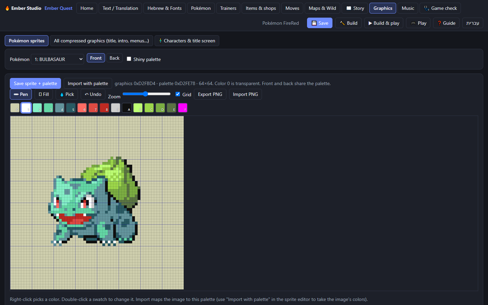

The **Graphics** tab has three parts:

- **Pokémon pictures**: front and back pictures, colours and icons of every Pokémon.
- **All graphics**: title, intro, sprites and more, everything compressed in the ROM.
- **🧍 Characters & title screen**: described below.

## A character from a picture

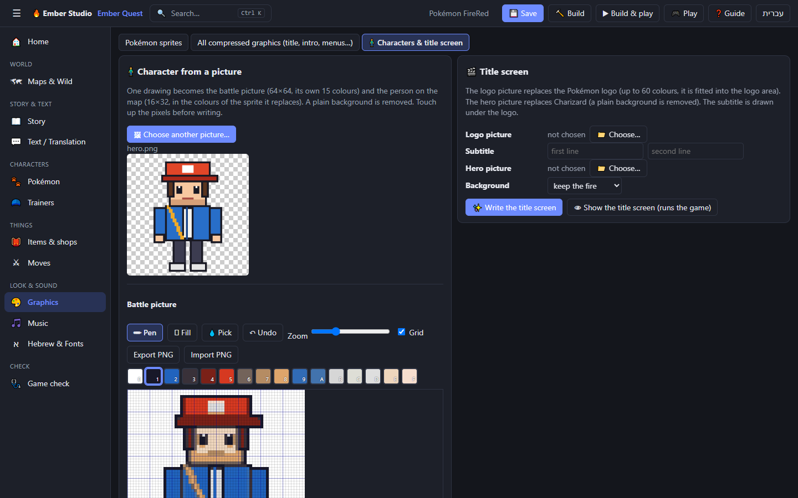

Make a new character, for example a new hero, from one picture:

1. Click **Choose a picture…** and pick any image with a transparent background (PNG or WebP).
2. Ember Studio makes the **battle picture** (64×64, up to 15 colours plus transparency) and the **map sprite** (16×32), in the colours of the character it replaces.
3. Choose which character to replace, and fix single pixels if you want: the editor has a pen, fill, a colour picker (Pick) and undo.
4. Write it to the game.

## The title screen

Under **🎬 Title screen**:

- **Logo picture** replaces the Pokémon logo (up to 60 colours, fitted to the logo area).
- **Subtitle** is one or two lines under the logo.
- **Hero picture** is a large character on the title screen.
- **Background**: keep the original, or a new one.

Press **✨ Write the title screen**. **👁 Show the title screen** runs the game in the background and shows you the result.

# Music

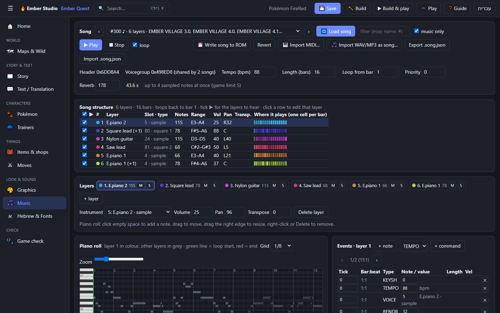

- **Which song plays where**: for each map, battle type and event.
- **Listen** to every song in the game, inside the editor.
- **Import music**: **🎹 Import MIDI…** or **🎵 Import WAV/MP3 as song…**. The song is written into free space in the game, and you choose where it plays.

# Game check

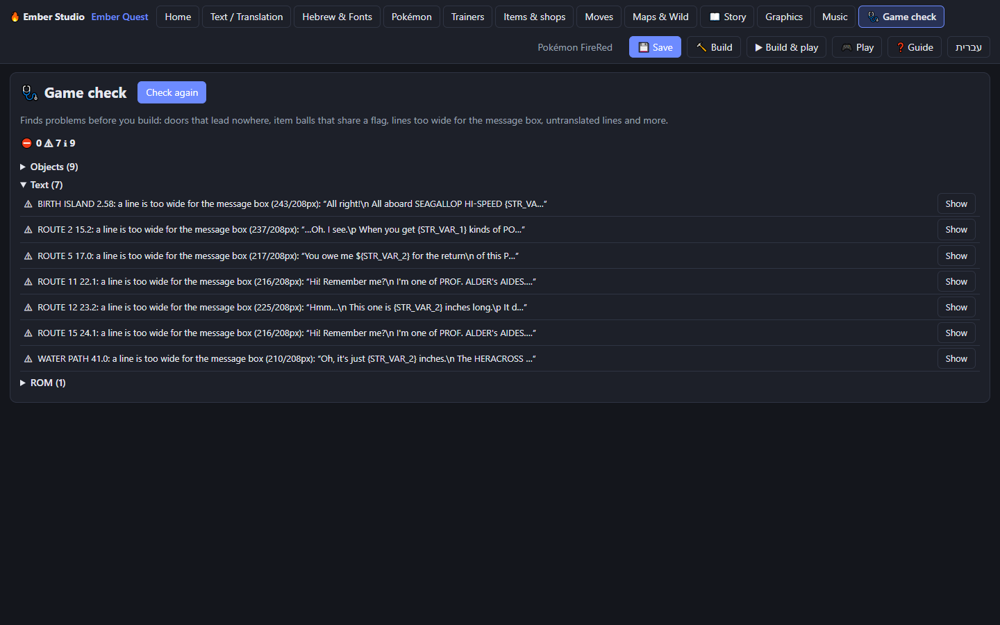

Before sharing your game, open **🩺 Game check**. It goes through the whole game and lists problems by category:

| Problem | Why it matters |
|---|---|
| A map that can't be loaded | The game would crash there. |
| A door that leads to a map that doesn't exist, or to a door number the map doesn't have | The player gets stuck or the game crashes. |
| An object outside the map | Often intended (someone who walks in during a scene), so this is only a note. |
| An item ball with no flag, or two balls sharing a flag | The item comes back every time, or picking one hides the other. |
| The same trainer used twice | Beating one counts for both. |
| A line too wide for the message box | The text gets cut off. |
| A line still in English (in a Hebrew game) | Something was left untranslated. |
| A gym leader weaker than the one before | The difficulty goes backwards. |
| Almost no free space left in the ROM | New scripts and pictures may not fit. |

Each problem has a **Show** button that takes you to the right place. Press **Check again** after fixing things.

# Playing and testing

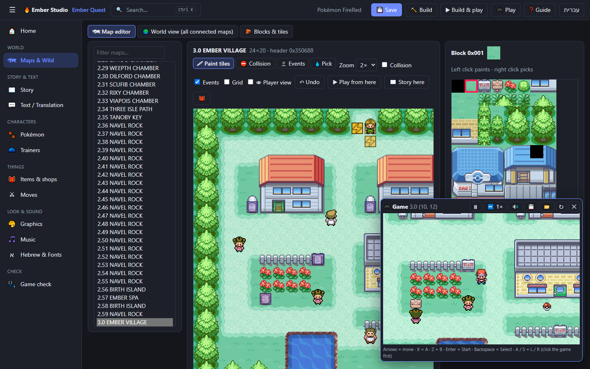

Ember Studio has the **mGBA** emulator built in. It opens in a window inside the editor.

## Ways to play

| Button | Where the game starts |
|---|---|
| **🎮 Play** | From the beginning, as the game is right now. |
| **▶ Build & play** | Builds `out/game.gba`, then plays it from the beginning. |
| **▶ Play from here** (map editor or world view) | On the spot you click, with a test team. |
| **▶ Test from this step** (story) | Right before that step of the story, with the story stage set. |

## Keys

| Keyboard | GBA |
|---|---|
| Arrow keys | D-pad |
| <kbd>X</kbd> | A |
| <kbd>Z</kbd> | B |
| <kbd>Enter</kbd> | Start |
| <kbd>Backspace</kbd> | Select |
| <kbd>A</kbd> / <kbd>S</kbd> | L / R |

Click the game picture first so it gets the keys.

## The emulator window

- **⏸** pauses and resumes.
- **×1 / ×2 / ×4 ⏩** is fast forward. It's great for walking long distances or skipping the intro.
- **🔊** turns the sound on or off.
- **💾 / 📂** save and load a state, a snapshot of the exact moment.
- **↻** restarts.
- **✕** closes.

## The test team

**▶ Play from here** and **Test from this step** give the player a test team, so you can battle right away. Change it with the **🎒** button: choose Pokémon and levels.

> **Tip:** The test only changes a copy of the game in memory. Your project is not touched.

# Projects and sharing

## What is inside a project folder

```
My Game/
  project.json        name, language, base ROM, build steps
  rom/patch.bin       your changes to the ROM (small)
  data/*.json         the story, scripts, test team, Pokémon edits, map moves (readable)
  out/game.gba        the built game (not saved in Git)
  README.md, .gitignore
```

- The project **never contains the original ROM**. When you open a project on another computer, Ember Studio asks for your own FireRed ROM once, and checks that it's the right one.
- Everything except `out/` is small and readable, which makes it perfect for **Git**: you can see what changed and go back to any version.

## Using Git

```
cd "My Game"
git init
git add .
git commit -m "First version"
```

The `.gitignore` that Ember Studio creates already leaves out `out/` and save files. You can put the project on GitHub and work on it with friends. Each person needs their own ROM.

## Sharing your game

You must not share the ROM itself (`out/game.gba`), because it contains Nintendo's game. Share one of these instead:

- **The project folder** (or its Git repository). Others open it in Ember Studio with their own ROM.
- **A patch** that turns the original FireRed into your game. Make one from the original ROM and `out/game.gba` with a free tool such as *Floating IPS (Flips)*. Players apply it to their own ROM with the same tool. (When you edit a ROM file directly, without a project, the **IPS file** button in the top bar makes the patch for you.)

## Turning an existing ROM into a project

**📥 Turn a ROM into a project** takes a finished hack or translation and makes a project from it:

1. Choose the `.gba` file.
2. Choose the original FireRed (US) v1.1.
3. Ember Studio saves the difference as `rom/patch.bin`.

From then on, you work on it like any other project.

## Build steps (advanced)

A project can run its own **build steps**: Python scripts that run during the build and change the game further. The example game *Kachol-Lavan* uses one for its title screen and graphics. Steps are listed in `project.json`. Ember Studio runs them only when their files change, so builds stay fast.

# Troubleshooting

**Windows says the app is not recognised.**
Click *More info → Run anyway*. See *Installing*.

**"This is not FireRed (US) v1.1".**
Ember Studio only works with that version: game code BPRE, revision 1. Other versions (v1.0, European, Japanese) have the data in different places.

**The emulator window stays black.**
Wait a few seconds: the first start copies the emulator. If it stays black, close the window with ✕ and press Play again.

**▶ Play from here does nothing.**
In the world view, first click a map to select it. The button is grey until a map is selected.

**I changed the story, but nothing changed in the game.**
Press **✨ Apply the story to the game** after changing steps, then test again.

**The game crashes when entering a door.**
Run the **🩺 Game check**. It finds doors that lead nowhere.

**The text is cut off.**
The line is too wide. Break it into two lines. The Text tab shows too-wide lines in red.

**I want to undo everything.**
If you use Git, go back to an older commit. If not, the project's `rom/patch.bin` is your work: keep copies of the folder from time to time.

**Where are my settings?**
In `%LOCALAPPDATA%\EmberStudio`. Delete that folder to reset Ember Studio. Your projects are not there, so they are safe.

# Licences and thanks

- **Ember Studio** is free software under the **GNU General Public License v3.0** (GPL-3.0). You can use, change and share it. If you share a changed version of the program, you must share its source code too.
- **Games you make** with Ember Studio are yours. The GPL applies to the editor, not to your game. Pokémon and FireRed belong to Nintendo, Game Freak and The Pokémon Company. Share patches or projects, not ROMs.
- **mGBA** (the built-in emulator) is by Vicki Pfau and contributors, under the Mozilla Public License 2.0. The WebAssembly build is by thenick775.
- **pywebview**, **Pillow** and **PyInstaller** are used under their own licences.

This guide was made from the program itself: all the pictures are taken automatically from Ember Studio. Corrections and translations are welcome on GitHub.
