# ברוכים הבאים

**Ember Studio** היא תוכנה חינמית בקוד פתוח ליצירת משחק פוקימון משלכם. מתחילים מעותק של *Pokémon FireRed (US) v1.1*, ומשנים כל מה שרוצים: המפות והדמויות שבהן, העלילה, הפוקימונים, המאמנים, החפצים, הטקסט, הגרפיקה והמוזיקה. התוצאה היא משחק GBA חדש, שאפשר לשחק בו בכל אמולטור או במחסנית.

לא צריך לדעת לתכנת, לערוך בהקסה או לכתוב אסמבלי. הכול נעשה בטפסים, בצייר מפות וב**בלוקים**: כרטיסים צבעוניים שמסדרים אחד מתחת לשני כדי לקבוע מה קורה במשחק ("להגיד את זה", "לתת שיקוי", "ללכת שלושה צעדים שמאלה").

## מה אפשר לעשות

- **להתחיל משחק חדש בכמה דקות** בעזרת אשף *משחק חדש*. בוחרים את השם, את השפה (עברית או אנגלית), את הפרופסור, את שלושת הפוקימונים ההתחלתיים, את שמות הערים ואת מנהיגי המכונים.
- **לבנות מפות**: לצייר בלוקים, לסמן איפה אפשר ללכת, ולמקם דמויות, מאמנים, חפצים ושלטים. אפשר גם ליצור בלוקים חדשים מכל תמונה.
- **לכתוב עלילה** כרשימת צעדים: לדבר עם מישהו, לנצח מאמן, להגיע למקום, סצנה, בחירה של כן/לא, קרב ביריב. Ember Studio הופכת את הצעדים לסקריפטים של המשחק בשבילכם.
- **לשנות פוקימונים** (נתונים, סוגים, מהלכים, התפתחויות), **פוקימונים בטבע**, **מאמנים ומנהיגי מכונים**, **חפצים וחנויות**, ו**מהלכים, TM ומורים**.
- **לתרגם** את כל הטקסט, עם תמיכה מלאה בעברית מימין לשמאל.
- **להחליף גרפיקה**: גיבור או דמות חדשה מתמונה, מסך כותרת משלכם, ובלוקים חדשים למפות.
- **לשחק מיד** באמולטור המובנה. אפשר להתחיל מההתחלה, או מכל נקודה בכל מפה עם **▶ שחק מכאן**.
- **לבדוק את המשחק** ולמצוא טעויות נפוצות לפני ששולחים אותו לאחרים.

## איך המדריך בנוי

1. **התקנה** של Ember Studio והפעלה.
2. **המשחק הראשון** עם האשף.
3. **סיור בחלון**.
4. פרק לכל חלק במשחק: מפות ועולם, אובייקטים ובלוקים, עלילה, פוקימונים, מאמנים, חפצים, מהלכים, טקסט, גרפיקה ומוזיקה.
5. **בדיקה ומשחק**, **בדיקת משחק**, ו**פרויקטים ושיתוף**.
6. **פתרון בעיות**, ורישיונות.

> **טיפ:** התמונות במדריך לקוחות ממשחק הדוגמה *הרפתקת הגחלת*, שנוצר עם האשף. המסכים שלכם ייראו אותו דבר, עם השמות והפוקימונים שלכם.

## חשוב: קובץ ה-ROM

Ember Studio **לא** כוללת אף משחק של נינטנדו. צריך עותק משלכם של **Pokémon FireRed (US) גרסה 1.1**, כקובץ `.gba`. הקובץ המקורי אף פעם לא משתנה: הפרויקט שומר רק *את השינויים שלכם*. כך אפשר לשתף פרויקט, או טלאי (patch) שנוצר ממנו, בלי לשתף את המשחק עצמו.

# התקנה והפעלה

## מה צריך

- Windows 10 או 11, ‏64 ביט.
- **Microsoft Edge WebView2**. הוא חלק מ-Windows 10/11, וכמעט תמיד כבר מותקן.
- קובץ ה-ROM של FireRed (US) v1.1.
- כ-200MB פנויים בדיסק.

## התקנה

Ember Studio היא קובץ אחד, **`EmberStudio.exe`**, ואין מה להתקין. מורידים אותו מדף ה-*Releases* של הפרויקט ב-GitHub ושמים בכל תיקייה, למשל `Documents\Ember Studio`. לחיצה כפולה מפעילה אותו.

### ההודעה "Windows הגן על המחשב שלך"

בהפעלה הראשונה, SmartScreen של Windows עשוי להציג חלון כחול שאומר שהיישום לא מוכר. זה קורה לתוכנות חדשות של פרויקטים קטנים בקוד פתוח, ולא בגלל שמשהו לא בסדר.

1. לוחצים על **מידע נוסף** (More info).
2. לוחצים על **הפעל בכל זאת** (Run anyway).

קובץ ה-EXE חתום, ואפשר לראות את התעודה ב-*מאפיינים ← חתימות דיגיטליות*. Windows סומכת על חתימה חדשה רק אחרי שהרבה אנשים הורידו את התוכנה. אם מעדיפים, אפשר גם לבנות את ה-EXE בעצמכם מקוד המקור (ראו *פרויקטים ושיתוף*).

## מה קורה בהפעלה הראשונה

- העורך נפתח בחלון משלו.
- האמולטור המובנה (mGBA) מועתק פעם אחת ל-`%LOCALAPPDATA%\EmberStudio\mgba`.
- ההגדרות, השפה, השמירה האוטומטית ותיקיית עבודה נשמרות ב-`%LOCALAPPDATA%\EmberStudio`. הפרויקטים עצמם נשמרים איפה שתבחרו, בדרך כלל ב-`Documents`.

## בחירת שפה

הכפתור בפינה העליונה עובר בין **עברית** ל-**English**. כל הממשק מתחלף מיד, ובעברית הוא מסודר מימין לשמאל. לשפת *הממשק* אין קשר לשפת *המשחק שלכם*: אפשר ליצור משחק באנגלית עם ממשק בעברית, וגם להפך.

## הפעלה מקוד המקור

למפתחים, או למי שלא רוצה להריץ EXE:

```
python editor/ember/server.py      # פותח את העורך בדפדפן בכתובת http://localhost:8765
python editor/ember/app.py         # אותו חלון כמו ה-EXE (pip install pywebview pillow)
```

# המשחק הראשון: האשף

הדרך המהירה להתחיל היא האשף **משחק חדש**. הוא שואל כמה שאלות ויוצר פרויקט שלם שאפשר לשחק בו.

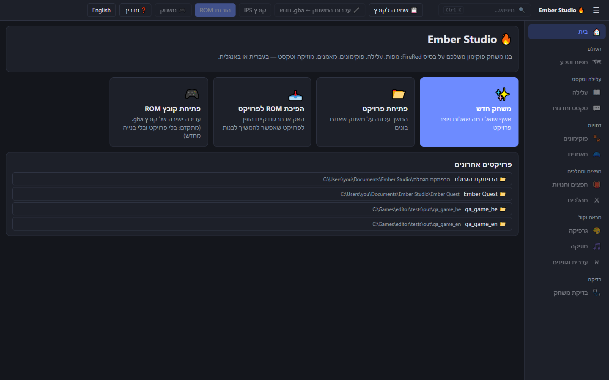

במסך הבית יש ארבע אפשרויות:

| כפתור | מה הוא עושה |
|---|---|
| **✨ משחק חדש** | שואל כמה שאלות ויוצר פרויקט. מתחילים כאן. |
| **📂 פתיחת פרויקט** | פותח תיקיית פרויקט שיצרתם קודם. |
| **📥 הפיכת ROM לפרויקט** | לוקח האק או תרגום קיים (קובץ `.gba`) והופך אותו לפרויקט, כדי שתוכלו להמשיך לבנות אותו. |
| **🎮 פתיחת קובץ ROM** | עריכה מהירה של קובץ `.gba` ישירות, בלי פרויקט ובלי בנייה. מתאים לתיקונים קטנים. |

מתחת לכפתורים מופיעים הפרויקטים האחרונים. לחיצה על אחד פותחת אותו.

## שלב 1: הבסיס

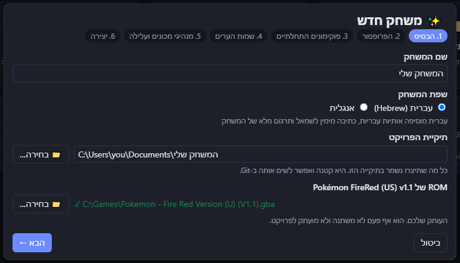

- **שם המשחק**: מופיע בשורת הכותרת ונשמר בפרויקט. אפשר לשנות אחר כך.
- **שפת המשחק**:
  - **עברית** מוסיפה אותיות עבריות, כתיבה מימין לשמאל ותרגום מלא של המשחק לעברית.
  - **English** משאירה את המשחק באנגלית.
- **תיקיית הפרויקט**: כל מה שתיצרו נשמר כאן. התיקייה קטנה (בדרך כלל פחות מ-1MB) ומתאימה מאוד ל-Git.
- **ROM של FireRed**: העותק שלכם של FireRed (US) v1.1. ‏Ember Studio בודקת שזו הגרסה הנכונה. הקובץ אף פעם לא משתנה ולא מועתק לפרויקט.

## שלב 2: הפרופסור

בוחרים את שם הפרופסור. כל השורות של הפרופסור מתעדכנות לשם החדש.

## שלב 3: פוקימונים התחלתיים

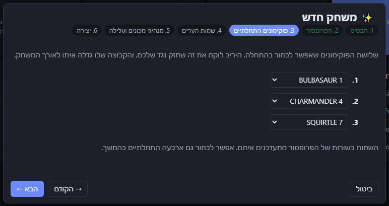

בוחרים את שלושת הפוקימונים שהשחקן יכול לבחור בהתחלה, מבין 386 הפוקימונים הראשונים. ‏Ember Studio מעדכנת כל מה שתלוי בבחירה:

- הכדורים על השולחן של הפרופסור;
- מה שהפרופסור אומר עליהם;
- הקבוצה של היריב, שגדלה איתו לאורך המשחק.

## שלב 4: שמות הערים

משנים את שמות הערים והכפרים. השמות החדשים מופיעים על השלטים, במפת העיר, בהודעת "הגעתם אל…" ובכל הדיאלוגים.

## שלב 5: מנהיגי מכונים ועלילה

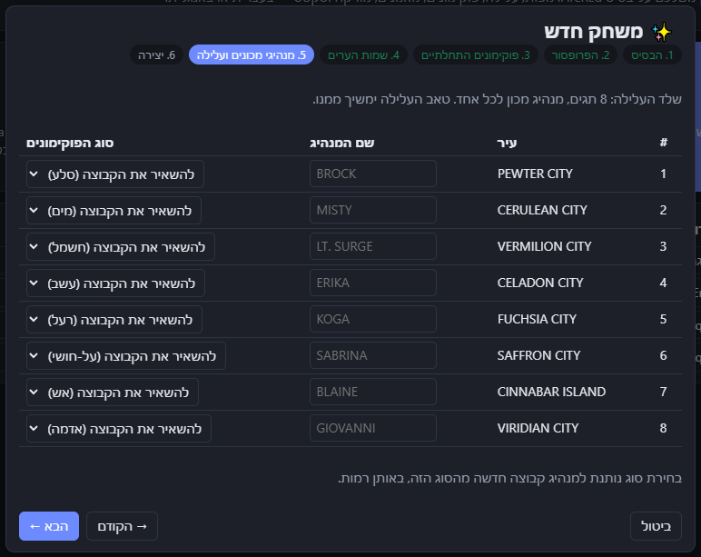

לכל אחד משמונת המכונים בוחרים את שם המנהיג ואת הסוג של הפוקימונים שלו. כל הקבוצה של המנהיג מתחלפת בפוקימונים מהסוג הזה, ברמות המתאימות.

האשף גם פותח את **העלילה** שלכם: פרק לכל תג, ובכל פרק צעד "לנצח את מנהיג המכון". את השאר ממלאים אחר כך בלשונית *עלילה*.

## שלב 6: יצירה

Ember Studio יוצרת את תיקיית הפרויקט ובונה את המשחק. אתם מגיעים לעורך כשהמשחק שלכם פתוח. לחיצה על **🎮 משחק** (או על **▶ בנייה ומשחק**) מאפשרת לנסות אותו מיד.

> **טיפ:** כל תשובה באשף אפשר לשנות אחר כך בעורך, אז לא צריך לדאוג שהכול יהיה מושלם בפעם הראשונה.

# סיור בחלון

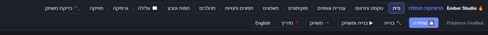

בחלק העליון של החלון יש:

- **הכותרת**: Ember Studio ושם הפרויקט הפתוח.
- **הלשוניות**, אחת לכל חלק במשחק:

| לשונית | מה עורכים בה |
|---|---|
| **בית** | פתיחה, יצירה או ייבוא של פרויקט. |
| **טקסט ותרגום** | כל הטקסט במשחק. |
| **עברית וגופנים** | אותיות עבריות, הגופן והגדרות מימין לשמאל. |
| **פוקימונים** | נתונים, סוגים, מהלכים, התפתחויות, התחלתיים ופוקימוני מתנה. |
| **מאמנים** | כל מאמן ומנהיג מכון והקבוצות שלהם. |
| **חפצים וחנויות** | חפצים, מחירים, תיאורים ומה כל חנות מוכרת. |
| **מהלכים** | מהלכים, TM ו-HM, ומורי מהלכים. |
| **מפות וטבע** | עורך המפה, תצוגת העולם, פוקימונים בטבע, ובלוקים ואריחים. |
| **📖 עלילה** | קו העלילה, צעד אחרי צעד. |
| **גרפיקה** | תמונות פוקימונים, דמויות מתמונה ומסך הכותרת. |
| **מוזיקה** | איזה שיר מתנגן איפה, וייבוא מוזיקה. |
| **🩺 בדיקת משחק** | מחפשת בעיות בכל המשחק. |

- **כפתורי הפרויקט**:
  - **💾 שמירה** כותבת את השינויים לתיקיית הפרויקט. ‏Ember Studio גם שומרת אוטומטית בזמן העבודה, כך שלא תאבדו הרבה אם משהו משתבש.
  - **🔨 בנייה** יוצרת את קובץ המשחק הסופי, `out/game.gba`.
  - **▶ בנייה ומשחק** בונה ואז פותחת את המשחק באמולטור.
  - **🎮 משחק** משחקת במשחק כמו שהוא עכשיו, בלי לבנות.
  - **English / עברית** מחליף את שפת הממשק.

## שמירה ובנייה בקצרה

- **שמירה** שומרת *את השינויים שלכם*: קובץ טלאי קטן וכמה קובצי JSON קריאים.
- **בנייה** מחילה את השינויים על ה-ROM המקורי וכותבת משחק שלם ל-`out/game.gba`.
- אפשר לשמור כמה שרוצים. צריך לבנות רק כשרוצים את הקובץ הסופי: כדי לשתף אותו, או לשחק בו באמולטור אחר.

# מפות

בלשונית **מפות וטבע** יש שלוש תצוגות למעלה: **עורך מפה**, **תצוגת עולם** (כל המפות המחוברות יחד) ו**בלוקים ואריחים**.

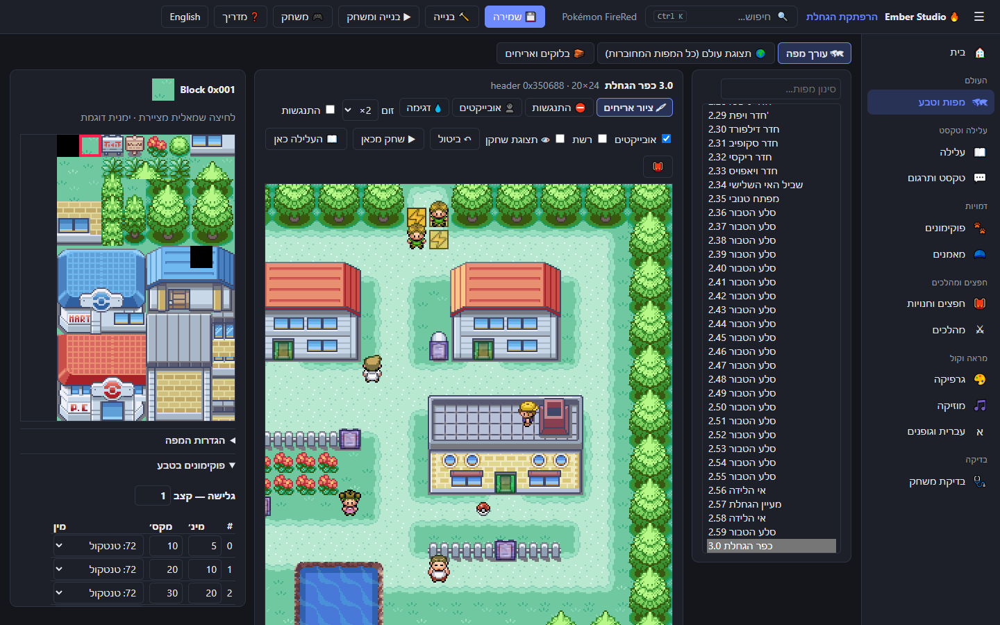

## מציאת מפה

הרשימה בצד מציגה את כל המפות במשחק, לפי מספר ושם, למשל *3.0 כפר הגחלת*. הקלדה בתיבה שמעל הרשימה מסננת אותה. המספרים הם *קבוצה.מפה*: קבוצה 3 היא הערים והדרכים בחוץ, ושאר הקבוצות הן בעיקר מבנים ומערות.

## ציור

1. בוחרים **🖌 ציור אריחים**.
2. לוחצים על בלוק בבורר הבלוקים שבצד.
3. לוחצים או גוררים על המפה כדי לצייר איתו.

כמה קיצורים שימושיים:

- **לחיצה ימנית** על בלוק במפה בוחרת אותו כמכחול.
- **💧 דגימה** לוקחת בלוק מהמפה, כמו לחיצה ימנית.
- **זום** משנה את הגודל, מ-×1 עד ×4.
- **ביטול** בכפתור ↶ או <kbd>Ctrl</kbd>+<kbd>Z</kbd>.

תיבות הסימון **התנגשות**, **אובייקטים** ו**רשת** מציגות או מסתירות את השכבות האלה מעל המפה.

## התנגשות: איפה אפשר ללכת

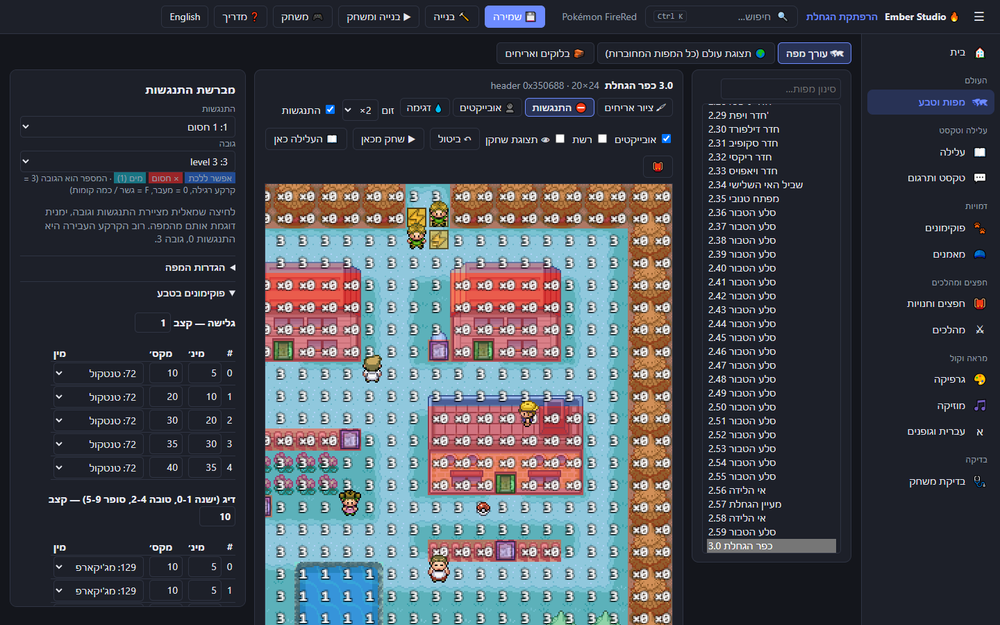

במצב **⛔ התנגשות** כל משבצת מראה אם אפשר ללכת עליה:

- **פנוי**: השחקן יכול ללכת כאן.
- **חסום**: קירות, עצים וקצוות של בניינים.
- **גובה**: לגשרים ולמדרגות.

בוחרים מכחול בחלונית *מכחול התנגשות* ומציירים על המפה. אם השחקן עובר דרך קירות או נתקע על רצפה ריקה, ההתנגשות לא נכונה. מתקנים אותה כאן.

## אובייקטים

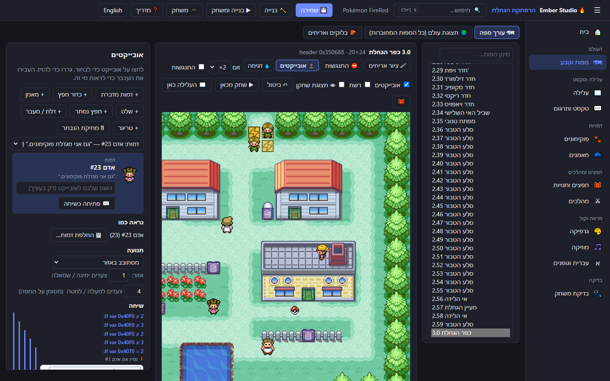

במצב **👤 אובייקטים** רואים כל מה ש*עושה* משהו במפה:

- **דמויות**: כל מי שהשחקן יכול לדבר איתו. הן יכולות לעמוד, להסתכל מסביב או להסתובב באזור.
- **מאמנים**: דמויות שנלחמות בשחקן כשהן רואות אותו.
- **כדורי חפץ**: כדורי פוקה על הקרקע עם חפץ בפנים.
- **שלטים**: טקסט שמופיע כשהשחקן קורא את השלט.
- **חפצים נסתרים**: חפצים שמוחבאים במשבצת, ומוצאים אותם בלחיצה על A שם.
- **טריגרים**: משבצות בלתי נראות שמפעילות סקריפט כשהשחקן עולה עליהן.
- **דלתות ומעברים**: המקומות שבהם השחקן עובר למפה אחרת.

כמה פעולות שימושיות:

- **הוספת אובייקט** בכפתורים שבחלונית הצד (**+ דמות מדברת**, **+ כדור חפץ**, **+ מאמן**, **+ שלט**, **+ חפץ נסתר**, **+ דלת / מעבר**, **+ טריגר**). אחר כך לוחצים על המפה כדי למקם אותו.
- **🗑 מחיקת הנבחר** מוחק את האובייקט הנבחר.
- **הזזה**: גוררים את האובייקט.
- **בחירה**: לוחצים על האובייקט, וההגדרות שלו נפתחות בחלונית הצד.
- מעבר עם העכבר מעל אובייקט מראה מי הוא ומה הוא אומר.

הפרק הבא מפרט את האובייקטים.

## הגדרות המפה

תחת **הגדרות המפה** בחלונית הצד אפשר לשנות את שם המפה (כפי שהוא מופיע במשחק), את המוזיקה שלה, את **מזג האוויר** ואת **סוג המפה** (עיר, דרך, מבנה, מערה…).

## ▶ שחק מכאן

הכפתור **▶ שחק מכאן** מאפשר לבדוק כל נקודה במשחק:

1. לוחצים על **▶ שחק מכאן**. הסמן הופך לכוונת.
2. לוחצים על משבצת כלשהי במפה.
3. המשחק מתחיל *בדיוק שם*, עם קבוצת בדיקה, כך שאפשר מיד להסתובב ולדבר עם אנשים.

זו הדרך הכי מהירה לבדוק שינוי. את קבוצת הבדיקה משנים בכפתור 🎒.

# תצוגת עולם

**תצוגת עולם** מראה את כל המפות שמחוברות זו לזו, מסודרות כמו במשחק. כאן רואים את הצורה של האזור שלכם, מזיזים מפות זו ביחס לזו ומציירים מעבר לגבולות של מפות.

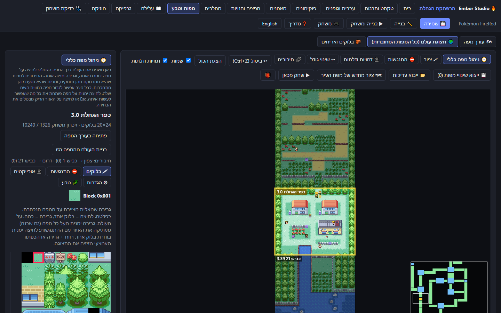

## מה אפשר לעשות כאן

- **תנועה**: גוררים עם העכבר כדי לזוז, וגלגלת העכבר עושה זום. המפה הקטנה בפינה מראה איפה אתם.
- **🧭 ניהול מפה כללי** (המצב הראשון, וגם כפתור בראש חלונית הצד): לחיצה על מפה בוחרת אותה, וגרירה מזיזה אותה לכל מקום. החיבורים למפות שהיא מתרחקת מהן נמחקים, ומפות שהיא נוגעת בהן אחרי ההזזה מתחברות. Ctrl+Z מבטל.
- **ביטול בחירה**: Esc, לחיצה על האזור הריק (במצב ניהול), או "ביטול בחירה" בתפריט של הלחצן הימני.
- **תווית השם** של כל מפה: גרירה שלה מזיזה את המפה בכל מצב, גם באמצע ציור.
- **לחיצה ימנית על מפה** פותחת תפריט עם כל מה שאפשר לעשות בה: בחירה או ביטול בחירה, ציור, התנגשות, דמויות ודלתות, שינוי גודל, חיבורים, לקחת את הבלוק שמתחת לעכבר, שחק מכאן, פתיחה בעורך המפה, בניית העולם מהמפה הזו ומחיקת המפה. גרירה עם הלחצן הימני עדיין מעתיקה בלוקים.
- מפה שלא נשארה מחוברת לשום מפה נשארת במקום שבו שמתם אותה, עם הסימון *לא מחוברת*.
- **בחירת מפה** בלחיצה עליה. חלונית הצד מראה את השם, הגודל והחיבורים שלה, וכפתורים לפתיחה שלה בעורך המפה.
- **ציור** על כל מפה, בדיוק כמו בעורך המפה. הציור עובד גם מעבר לגבולות בין מפות.
- **↔ שינוי גודל: גוררים צלע**: מסגרת צהובה עבה מופיעה סביב המפה. גוררים צלע או פינה כדי להגדיל או להקטין את המפה, כמו חלון.
- **🗑 מחיקת המפה** (בתפריט של הלחצן הימני) מוחקת את כל החיבורים של המפה, והמפה יוצאת מהעולם. היא יוצאת גם מרשימת המפות של המשחק רק כשהיא האחרונה בקבוצה שלה ואף דלת לא מובילה אליה (למשל מפה חדשה שיצרתם). אחרת היא נשארת ברשימה, כי מחיקה מהאמצע משנה את המספרים של המפות שאחריה ושוברת את הדלתות שלהן. השאלה שלפני המחיקה אומרת מאילו מפות יש דלתות אליה.
- **🔗 חיבורים** מראה ועורך איזו מפה מובילה לאיזו.
- **🗺 ציור מחדש של מפת העיר** מצייר מחדש את מפת האזור במשחק, כך שתתאים לעולם שלכם.
- **💾 ייצוא שינויי מפות** ו-**📂 ייבוא עריכות** שומרים את עריכות העולם בקובץ (`world_edits.json`) וטוענים אותן לעותק אחר של המשחק.

אם שתי מפות חופפות, או שהחיבורים שלהן לא מתאימים, מופיעה אזהרה מעל המפה. כדאי לתקן לפני ששולחים את המשחק.

## מעבר בדלתות

במצב **👤 דמויות ודלתות** אפשר לעבור בדלת אל המפה שהיא מובילה אליה, ולחזור:

- **לחיצה ימנית על דלת** ובחירה ב-*🚪 מעבר בדלת אל …*, או **דאבל-קליק על הדלת**.
- אם המפה שמאחורי הדלת כבר נמצאת בעולם (למשל מערה שיוצאת לכביש אחר), התצוגה קופצת אליה. אחרת מוצגת המפה הזו לבדה (למשל פנים של בית).
- הדלת שאליה מגיעים בחורה ובמרכז, והפאנל שלה פתוח בצד.
- **↩ חזרה אל …** (בתפריט של הלחצן הימני, וגם כפתור בסרגל) חוזרת צעד אחד, למפה שממנה הגעתם, והדלת שממנה יצאתם בחורה.
- אחרי כמה שלבים פנימה (עיר ← בית ← קומה שנייה), **🌍 חזרה למפת העולם** חוזרת עד ההתחלה.
- יש דלתות שמחזירות את השחקן למקום שממנו הגיע (המשחק קובע). הן לא מובילות למפה קבועה, ולכן אי אפשר לעבור דרכן כאן.

## ▶ שחק מכאן (בתצוגת עולם)

זה עובד כמו בעורך המפה:

1. לוחצים על מפה כדי לבחור אותה. הכפתור **▶ שחק מכאן** משתנה מאפור לפעיל.
2. לוחצים על הכפתור.
3. לוחצים על נקודה במפה. המשחק מתחיל שם.

## פוקימונים בטבע

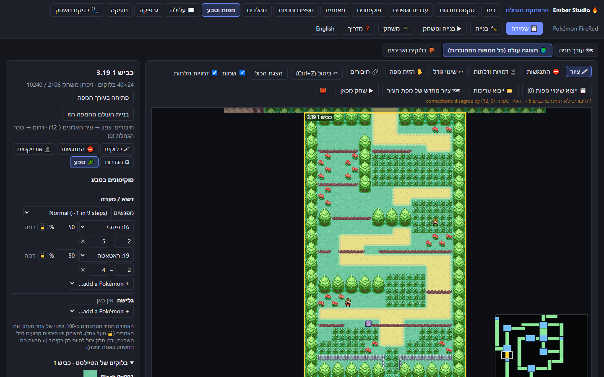

בוחרים מפה ופותחים בחלונית הצד את הלשונית **🌿 טבע**. לכל סוג של מפגש (*דשא / מערה*, *גלישה*, *דיג*, *ניפוץ סלעים*) אפשר:

- לבחור **כמה פעמים** יש מפגשים (נדיר, רגיל, הרבה…);
- להוסיף פוקימונים עם **+ הוספת פוקימון…**;
- לקבוע **טווח רמות** לכל פוקימון;
- לקבוע לכל אחד **סיכוי** באחוזים. הסיכויים תמיד מסתכמים ב-100: משנים אחד, והאחרים מתעדכנים. המנעול 🔒 שומר ערך קבוע.

המשחק האמיתי בוחר מפגשים מתוך משבצות קבועות, ולכן הסיכויים שמוצגים מעוגלים לערכים האפשריים הקרובים (≈).

# בלוקים ואריחים

מפות בנויות מ**בלוקים** של 16×16 פיקסלים. כל בלוק מורכב מארבעה **אריחים** של 8×8. הבלוקים של מפה מגיעים מה**טיילסט** שלה: טיילסט העיר, טיילסט המערה וכן הלאה.

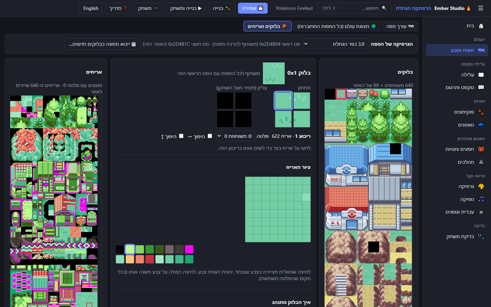

ב**בלוקים ואריחים** אפשר:

- לראות את כל הבלוקים של הטיילסט של המפה הנוכחית;
- לשנות איך כל בלוק נראה, ואם אפשר ללכת עליו;
- **לייבא תמונה כבלוקים חדשים**.

## ייבוא תמונה כבלוקים חדשים

זו הדרך הקלה להוסיף למפות משהו חדש, כמו פסל, דגל, בניין או שלט.

1. מציירים או מוצאים תמונה. הרוחב והגובה צריכים להיות כפולות של 16 פיקסלים, למשל 32×48.
2. לוחצים על **ייבוא תמונה כבלוקים חדשים** ובוחרים את הקובץ.
3. ‏Ember Studio חותכת את התמונה לבלוקים, מתאימה את הצבעים לפלטה של הטיילסט ומוסיפה את הבלוקים לטיילסט.
4. חוזרים לעורך המפה ומציירים עם הבלוקים החדשים.

> **טיפ:** תמונות עם מעט צבעים וקווי מתאר ברורים נראות הכי טוב. לכל טיילסט יש מספר מוגבל של צבעים, ו-Ember Studio בוחרת את הקרובים ביותר שיש לה.

# אובייקטים לעומק

לחיצה על אובייקט במצב **👤 אובייקטים** פותחת את ההגדרות שלו.

## דמויות

- **נראה כמו**: הדמות. **🖼 החלפת דמות…** פותח את כל הדמויות במשחק לבחירה.
- **תנועה**: עומדת, מסתכלת מסביב, מסתובבת באזור, או הולכת הלוך ושוב.
- **שיח**: מה קורה כשהשחקן מדבר איתה. ראו *בלוקים* בהמשך.
- **השם**: הערה בשבילכם, שמופיעה רק בעורך.

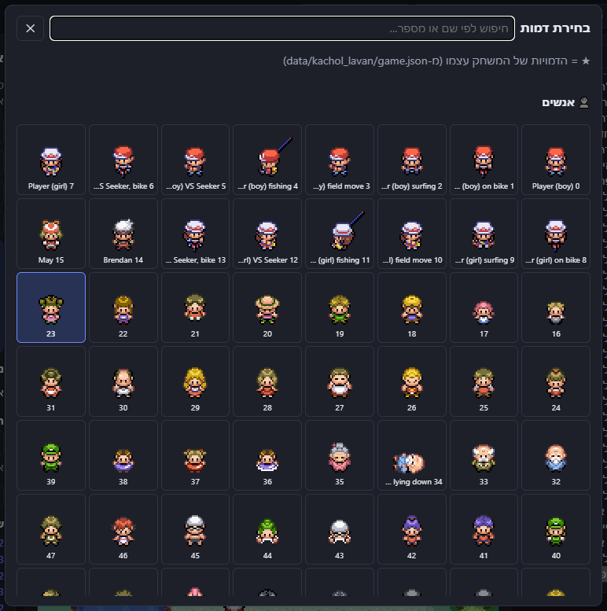

## מאמנים

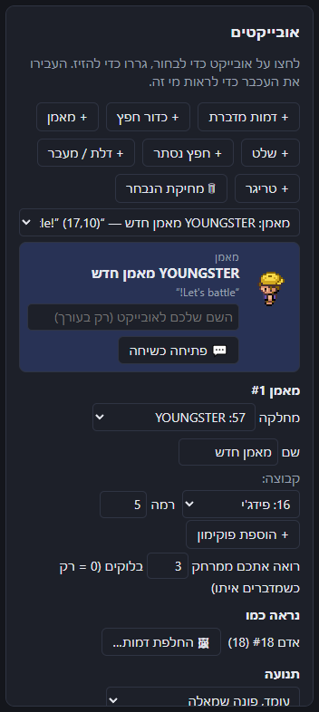

מאמן הוא דמות שנלחמת בשחקן כשהם נפגשים:

- **מאמן**: איזה מאמן מלשונית *מאמנים*. זה קובע את הקבוצה, המחלקה והתמונה.
- **טווח ראייה**: מכמה משבצות הוא מבחין בשחקן.
- **טקסט פתיחה וטקסט הפסד**: מה הוא אומר לפני הקרב ואחריו.
- **פתיחה בלשונית מאמנים**: מעבר לקבוצה שלו.

## כדורי חפץ

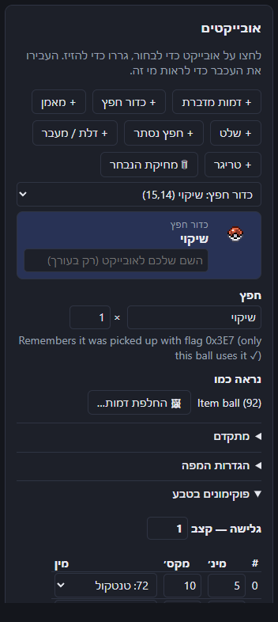

- **חפץ**: מה השחקן מקבל.
- **דגל**: זוכר שהכדור נאסף, כדי שלא יחזור. ‏Ember Studio בוחרת דגל פנוי לכדורים חדשים אוטומטית.

## שלטים וטריגרים

- **שלטים** מציגים טקסט כשהשחקן עומד מולם ולוחץ על A.
- **טריגרים** הם משבצות בלתי נראות שמפעילות סקריפט כשהשחקן עולה עליהן. משתמשים בהם לסצנות כמו "הפרופסור עוצר אתכם ביציאה מהעיר". ברוב המקרים תיצרו טריגרים דרך לשונית *עלילה*, שעושה את זה בשבילכם.

# בלוקים

**סקריפט** הוא מה שקורה כשהשחקן מדבר עם מישהו, קורא שלט או עולה על טריגר. ב-Ember Studio כותבים סקריפטים ב**בלוקים**. מסדרים אותם מלמעלה למטה, והמשחק מריץ אותם בסדר הזה.

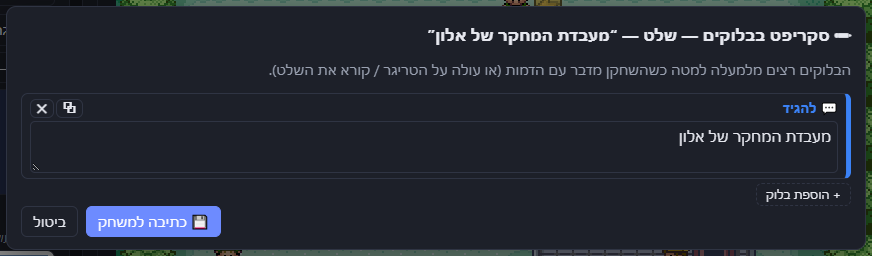

כדי לערוך סקריפט:

1. לוחצים על **לכתוב בבלוקים** (או **עריכת הבלוקים**) בדמות, בשלט או בטריגר.
2. לוחצים על **+ הוספת בלוק** ובוחרים בלוק.
3. ממלאים את השדות שלו.
4. גוררים בלוקים כדי לשנות את הסדר. **⧉** משכפל בלוק ו-**✕** מוחק אותו.
5. לוחצים על **💾 כתיבה למשחק**.

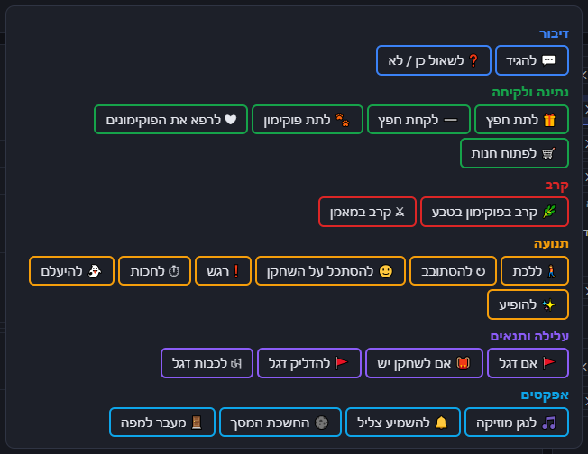

## כל הבלוקים

| קבוצה | בלוק | מה הוא עושה |
|---|---|---|
| **דיבור** | 💬 להגיד | מציג הודעה. Enter בטקסט יורד שורה. |
| | ❓ לשאול כן / לא | שואל שאלה. שמים בלוקים שונים תחת *כן* ותחת *לא*. |
| **נתינה ולקיחה** | 🎁 לתת חפץ | נותן לשחקן חפץ (וכמות). |
| | ➖ לקחת חפץ | לוקח חפץ. |
| | 🐾 לתת פוקימון | נותן פוקימון ברמה מסוימת, עם הודעה לבחירה. |
| | ❤ לרפא את הפוקימונים | מרפא את כל הקבוצה, כמו במרכז פוקימונים. |
| | 🛒 לפתוח חנות | פותח חנות עם החפצים שתבחרו. |
| **קרב** | 🌿 קרב בפוקימון בטבע | מתחיל קרב בפוקימון בטבע. |
| | ⚔ קרב במאמן | קרב במאמן, עם טקסט פתיחה וטקסט הפסד. |
| **תנועה** | 🚶 ללכת | מזיז את השחקן או דמות, צעד אחרי צעד, במהירות רגילה, איטית או מהירה. |
| | ↻ להסתובב | מסובב מישהו לכיוון מסוים. |
| | 🙂 להסתכל על השחקן | הדמות מסתובבת אל השחקן. |
| | ❗ רגש | מציג ❗, ❓ או ♥ מעל הראש של מישהו. |
| | ⏱ לחכות | מחכה מספר שניות. |
| | 👻 להיעלם / ✨ להופיע | מסתיר או מראה דמות. המשחק זוכר את זה. |
| **עלילה ותנאים** | 🚩 אם דגל | מריץ בלוקים שונים לפי דגל. |
| | 🎒 אם לשחקן יש | מריץ בלוקים שונים לפי אם יש לשחקן חפץ. |
| | 🚩 להדליק דגל / 🏳 לכבות דגל | זוכר (או שוכח) שמשהו קרה. |
| **אפקטים** | 🎵 לנגן מוזיקה | מחליף את המוזיקה. |
| | 🔔 להשמיע צליל | משמיע אפקט קולי. |
| | 🌑 החשכת המסך | מחשיך את המסך או מחזיר אותו. |
| | 🚪 מעבר למפה | שולח את השחקן למפה אחרת. |

> **מה זה דגל?** דגל הוא מתג של דולק/כבוי שהמשחק זוכר בקובץ השמירה. למשל "השחקן כבר קיבל את השיקוי מאמא". בזכות דגלים, דמויות אומרות משהו חדש בפעם השנייה שמדברים איתן, וחפצים לא חוזרים. לשונית *עלילה* מטפלת ברוב הדגלים בשבילכם.

## בחירת מקומות ודמויות

לשדות כמו *מי הולך*, *מי* או *איפה* יש כפתור **👆** (*בחירת הדמות במפה*, *בחירת המקום במפה*). לוחצים עליו ואז על המפה. אף פעם לא צריך להקליד קואורדינטות.

## תצוגה מקדימה

בלשונית *עלילה*, **▶ הפעלת התצוגה המקדימה** מציגה אנימציה מהירה של ההליכה וההודעות בסצנה, ישר בעורך. זו סקיצה בלבד, והתוצאה האמיתית נמצאת במשחק. כדי לראות אותה, משתמשים ב-**▶ שחק מכאן** או ב**בדיקה מהצעד הזה**.

# העלילה

בלשונית **📖 עלילה** כותבים את הסיפור של המשחק: מה השחקן צריך לעשות, באיזה סדר, ומה אנשים אומרים בדרך. לא כותבים סקריפטים ודגלים ביד. יוצרים רשימה של **צעדים**, ו-Ember Studio בונה את כל השאר.

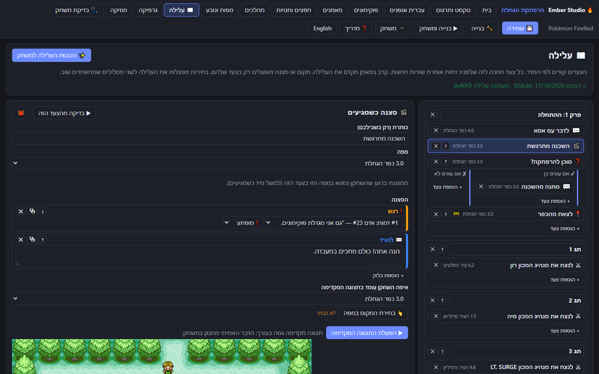

## איך זה עובד

- העלילה היא רשימה של **פרקים** (בצד), וכל פרק הוא רשימה של **צעדים**.
- הצעדים קורים **לפי הסדר**: כל צעד פותח את הבא.
- המשחק זוכר כמה רחוק השחקן הגיע במספר אחד, **שלב העלילה**. לא צריך לנהל אותו, אבל רואים בראש הלשונית באיזה משתנה הוא נשמר.

לחיצה על צעד פותחת את ההגדרות שלו מימין.

## סוגי צעדים

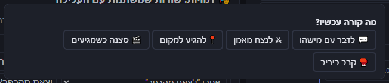

| צעד | מה קורה |
|---|---|
| 💬 **לדבר עם מישהו** | השחקן מדבר עם דמות, והבלוקים שכתבתם רצים. למשל: "אמא נותנת לכם נעלי ריצה". |
| ⚔ **לנצח מאמן** | השחקן צריך לנצח מאמן או מנהיג מכון. אפשר להוסיף בלוקים שרצים מיד אחרי הניצחון. |
| 📍 **להגיע למקום** | משהו קורה כשהשחקן עולה על משבצת. למשל: הפרופסור עוצר אתכם ביציאה מהעיר. |
| 🎬 **סצנה כשמגיעים** | סצנה שרצה ברגע שהשחקן מגיע למפה, למשל סצנת פתיחה בעיר חדשה. |
| ❓ **בחירה (כן / לא)** | מישהו שואל שאלה, והעלילה מתפצלת לשני מסלולים. |
| 🥊 **קרב ביריב** | קרב ביריב, שהקבוצה שלו תלויה בהתחלתי שהשחקן בחר. |

## כתיבת צעד

ברוב הצעדים ממלאים:

1. **כותרת (רק בשבילכם)**: שם קצר שמופיע ברשימה.
2. **מי** או **איפה**: הדמות, או המפה והמקום. משתמשים בכפתור 👆 לבחירה במפה.
3. **מה קורה**: בלוקים, בדיוק כמו בעורך הבלוקים.

בכל צעד יש כפתור **▶ בדיקה מהצעד הזה**. הוא מפעיל את המשחק ממש לפני הצעד, כששלב העלילה כבר מוגדר. כך רואים בדיוק מה שהשחקן רואה בנקודה הזאת, בלי לשחק את כל המשחק עד אליה.

## בחירות וסופים

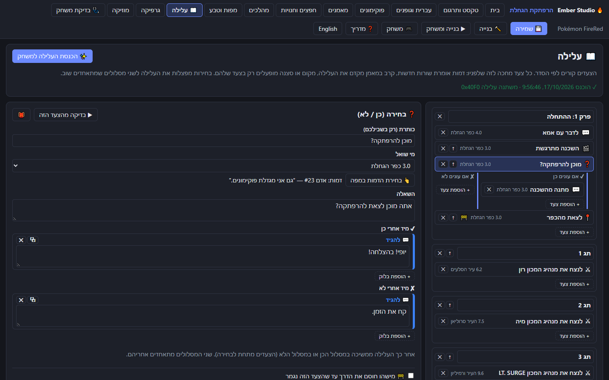

צעד **בחירה** שואל שאלה של כן/לא. מתחתיו יש שני טורים:

- **✔ אם עונים כן** עם צעדים משלו.
- **✘ אם עונים לא** עם צעדים אחרים.

לכל מסלול יכולים להיות צעדים משלו, סצנות משלו ואפילו סוף משלו. אחרי המסלולים העלילה ממשיכה יחד.

## מחסומים (שומרים)

הרבה פעמים אסור לשחקן להגיע למקום מסוים עדיין: "אי אפשר לצאת מהעיר בלי פוקימון!". בצעד **להגיע למקום** או בצעד **לדבר** אפשר להוסיף **שומר**: דמות שעומדת בדרך עד שהצעד מסתיים, ואז נעלמת. ‏Ember Studio דואגת להסתיר אותה ברגע הנכון.

## דמויות שמשתנות עם הזמן

תחת **דמויות: שורות שמשתנות עם העלילה**, דמות יכולה להגיד שורות שונות בנקודות שונות בעלילה. למשל, תושב אומר "שמעתי על פוקימון מוזר…" בהתחלה, ו"ניצחת את מנהיג המכון!" אחרי התג הראשון. מוסיפים שורה ובוחרים **אחרי "…"**: הצעד שאחריו היא מתחילה.

## הכנסת העלילה למשחק

לוחצים על **✨ הכנסת העלילה למשחק**. ‏Ember Studio כותבת למשחק את כל הסקריפטים, הטריגרים והסצנות. אפשר לשנות את העלילה ולהכניס אותה שוב בכל זמן: הגרסה הקודמת נמחקת קודם, כך ששום דבר לא נשאר מאחור.

> **טיפ:** עובדים בחלקים קטנים: כותבים צעד או שניים, מכניסים למשחק, ומנסים עם **בדיקה מהצעד הזה**.

## העלילה של המשחק

לשונית העלילה מציגה גם את העלילה **שכבר נמצאת במשחק**: אוק שעוצר אותך ליד הדשא, בחירת הפוקימון הראשון, הקרב ביריב, החבילה, כל מנהיגי המכונים, צוות רוקט, ארבעת הגדולים ועוד. ‏Ember Studio מוצאת אותה בעזרת מעקב אחרי כל הסקריפטים במשחק, ולכן זה עובד גם ב-FireRed וגם בהאקים שמבוססים עליו. לרגעים של FireRed המקורי יש שמות מדויקים. בהאק, מה שעדיין תואם שומר על השם, ומה שחדש מקבל שם לפי מה שהוא עושה.

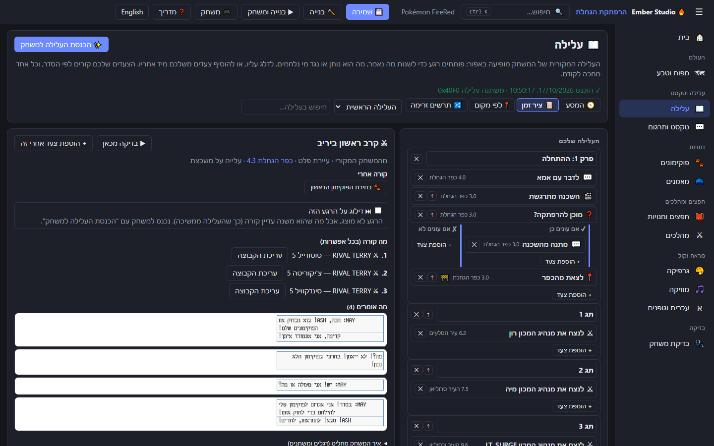

הרגעים של המשחק הם הכרטיסים האפורים תחת **העלילה של המשחק**, בפרקים לפי מקום: עיירת פלט, ורידיאן, פיוטר וכן הלאה. הצעדים שלכם מופיעים בצבע.

### שלוש דרכים להסתכל

הכפתורים למעלה עוברים בין שלוש תצוגות:

- **📜 ציר זמן**: כל העלילה, פרק אחרי פרק, לפי סדר המשחק.
- **📍 לפי מקום**: מפה אחת בכל פעם, עם כל מה שקורה בה לפי הסדר. למשל במעבדה של אוק: ההגעה, בחירת פוקימון, הקרב ביריב, ואז החבילה והפוקידקס. בעורך המפה, **📖 העלילה כאן** פותח את התצוגה הזאת למפה שבה אתם נמצאים.
- **🔀 תרשים זרימה**: תיבות וחיצים. חץ אומר "זה צריך לקרות קודם".

התפריט שלידם עובר בין **העלילה הראשית** ל**כל מה שקורה**, שמוסיף גם אירועי צד כמו מתנות, חכות דיג ומאמנים של צוות רוקט. תיבת החיפוש מוצאת רגע לפי שם או לפי מקום.

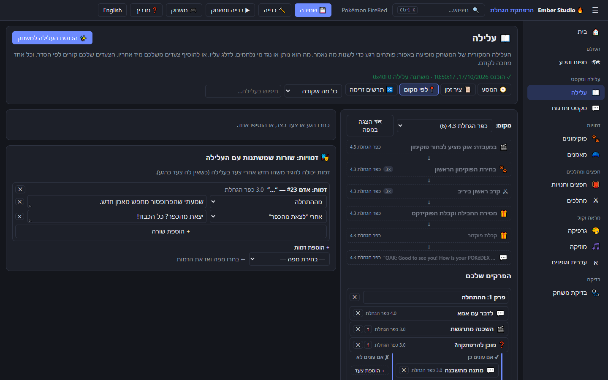

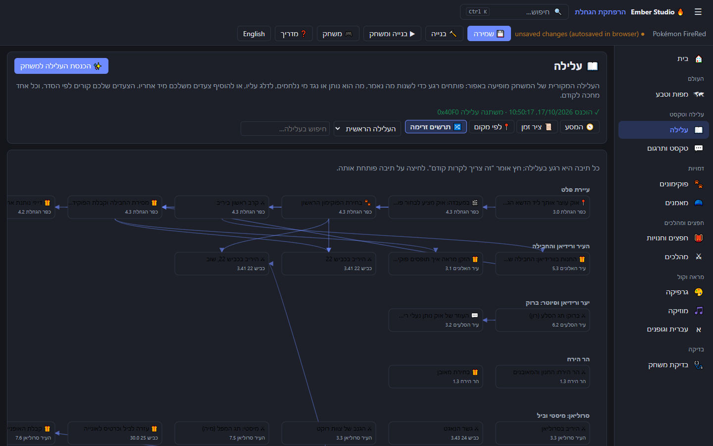

### שינוי רגע

לחיצה על רגע פותחת אותו מימין:

- **קורה אחרי**: הרגעים שצריכים לקרות קודם. לחיצה על אחד מהם עוברת אליו.
- **מה קורה**: הפוקימון או החפץ שהרגע נותן, והקרב. אפשר לשנות את הפוקימון, את הרמה שלו, את החפץ ואת הכמות. **עריכת הקבוצה** פותחת את המאמן בלשונית מאמנים. כשלרגע יש כמה אפשרויות, כל אחת מופיעה בנפרד: אחת לכל פוקימון התחלתי, או קבוצה אחרת של היריב לכל התחלתי.
- **מה אומרים**: כל השורות של הרגע. לחיצה על שורה פותחת אותה לעריכה, והתצוגה המקדימה מראה את תיבת ההודעות.
- **▶ בדיקה מכאן**: מתחיל את המשחק במקום שתבחרו, כשהדגלים והמשתנים מוגדרים כמו ממש לפני הרגע.
- **איך המשחק מחליט** (סגור בהתחלה): הדגלים והמשתנים שמאחורי הרגע, למי שרוצה לדעת.

שינויים בשורות, בפוקימונים, בחפצים ובקבוצות נכנסים למשחק מיד, כמו כל עריכה אחרת.

### דילוג על רגע

סימון **⏭ דילוג על הרגע הזה** מוציא רגע מהעלילה, למשל "אוק עוצר אותך ליד הדשא הגבוה". הרגע כבר לא מוצג, אבל מה שהוא משנה עדיין קורה, כך שהמשך העלילה לא נתקע. המתנות שלו ניתנות בשקט. הדילוג נכנס למשחק בלחיצה על **✨ הכנסת העלילה למשחק**, ואפשר לבטל את הסימון בכל זמן.

### הצעדים שלכם בין שני רגעים

הכפתור **+** ליד רגע (או **+ הוספת צעד אחרי זה**) פותח פרק משלכם מיד אחריו. זה מתאים למשל לסצנה חדשה בין בחירת הפוקימון לקרב ביריב:

1. לוחצים על **+** ליד **בחירת הפוקימון הראשון**.
2. מוסיפים צעדים, בדיוק כמו בפרקים האחרים שלכם.
3. מתחת לשם הפרק בוחרים איזה רגע של המשחק מחכה לו: כברירת מחדל הרגע הבא, כאן **קרב ראשון ביריב**. אפשר גם לבחור *המשחק ממשיך כרגיל*.
4. לוחצים על **✨ הכנסת העלילה למשחק**.

עכשיו הקרב ביריב לא מתחיל עד שהצעדים שלכם נגמרים. לכל פרק כזה יש משתנה עלילה משלו, כך שפרק אחרי היריב לא מחכה לפרק אחרי ברוק.

> **טיפ:** הביטול מדויק. מבטלים דילוג או מוחקים את הפרק, מכניסים שוב את העלילה למשחק, והסקריפטים של המשחק חוזרים בדיוק כמו שהיו, בייט אחרי בייט.

# פוקימונים

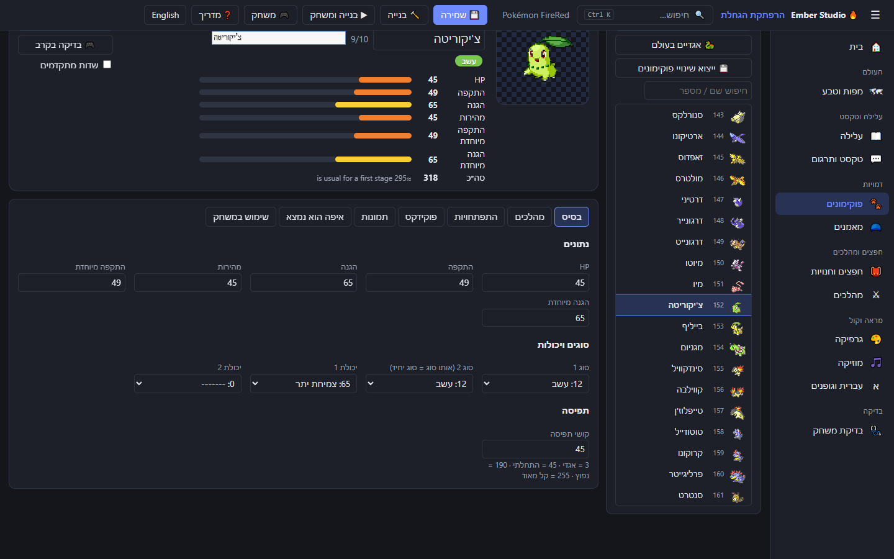

בוחרים פוקימון מהרשימה (אפשר לחפש לפי שם או מספר). אפשר לשנות:

- **נתוני בסיס**: חיים, התקפה, הגנה, מהירות, התקפה מיוחדת והגנה מיוחדת. הסכום מוצג.
- **סוגים ויכולות.**
- **סיכוי לכידה, ניסיון, יחס זכר/נקבה** וקבוצות ביצים.
- **התפתחויות**: באיזו רמה, באיזו אבן או בהחלפה.
- **מהלכים לפי רמה**: אילו מהלכים לומדים בכל רמה.
- **התאמה ל-TM/HM**: אילו TM הוא יכול ללמוד.
- **הערך בפוקידקס.**

## התחלתיים, פוקימוני מתנה וקרבות קבועים

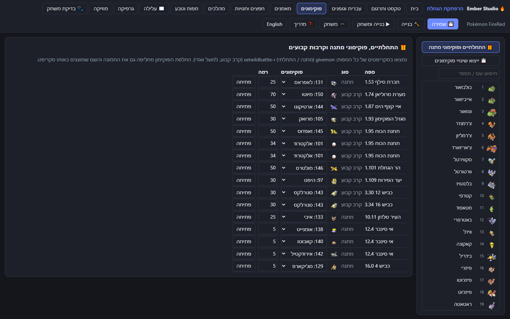

**🎁 התחלתיים ופוקימוני מתנה** מציג כל מקום במשחק שבו השחקן מקבל פוקימון או פוגש פוקימון קבוע:

- ההתחלתיים;
- מתנות, כמו הלאפרס בחברת סילף;
- קרבות קבועים, כמו סנורלקס או הציפורים האגדיות.

משנים את הפוקימון או את הרמה, ו-Ember Studio משנה את הסקריפט ואת התמונה שמוצגת איתו.

**💾 ייצוא שינויי פוקימונים** שומר את שינויי הפוקימונים בקובץ, שאפשר לשתף או לייבא לפרויקט אחר.

# מאמנים

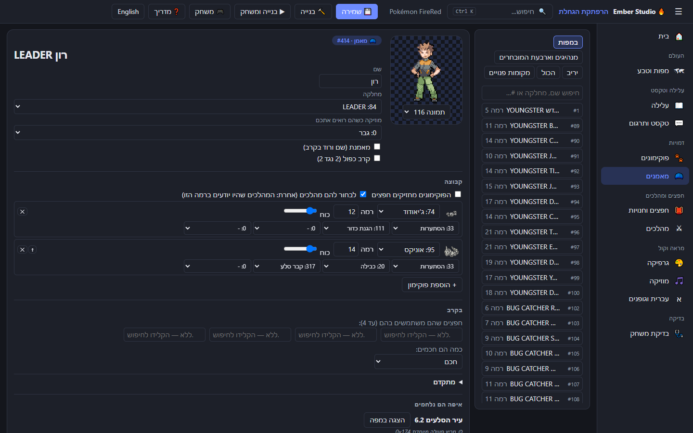

בצד מופיעה רשימת כל המאמנים. אפשר לסנן אותה ולהציג רק **מנהיגים ויריבים**, לפי **מפה** או לפי **מחלקה**. לכל מאמן אפשר לשנות:

- **שם** ו**מחלקה** (צעיר, נערה, מנהיג…), ואת **המוזיקה** שמתנגנת כשהוא רואה אתכם.
- **תמונה**: תמונת הקרב של המאמן.
- **קרב כפול**: קרב עם שני פוקימונים בבת אחת.
- **קבוצה**: עד שישה פוקימונים, כל אחד ברמה משלו, ואם רוצים גם עם מהלכים וחפץ מוחזק משלו.
- **חפצים** שהמאמן משתמש בהם בקרב (עד ארבעה), ו**כמה הוא חכם**.

## קושי לאורך העלילה

הגרף **📈 קושי לאורך העלילה** מציג כל מאמן כנקודה: כמה חזק הפוקימון הכי חזק שלו, מתחילת המשחק ועד סופו. מנהיגי מכונים בזהב, יריבים בכחול, ומאמנים שחזקים או חלשים בהרבה מהמאמנים סביבם באדום.

- לחיצה על נקודה פותחת את המאמן.
- **להתאים אותם לעקומה** מתקן את המאמנים הבולטים.
- **כל המאמנים במפה… %** מחזק או מחליש את כל המאמנים של מפה באחוז מסוים.

# חפצים וחנויות


לכל חפץ:

- **שם**, **מחיר** ו**תיאור**, איפה הוא נמכר ואיפה הוא מונח במפות.
- **כיס** (חפצים, חפצי מפתח, כדורי פוקה, TM, פירות).

## ✨ מה החפץ עושה

בראש הכרטיס כמה משפטים קצרים מסבירים מה החפץ עושה, למשל *מרפא 20 HP* או *סיכוי התפיסה ×2*. מתחתם יש שדות למה שאפשר לשנות:

- **כדורים:** תוספת התפיסה של כדור אולטרה, גרייט, פוקי וספארי (×2 = פי שניים יותר קל מכדור פוקי). הכללים של הכדורים המיוחדים (רשת, קן, טיימר…) כתובים בקוד של המשחק, ולכן הם מוסברים אבל אי אפשר לשנות אותם.
- **תרופות:** כמה HP מרפאות (כמות, הכול או חצי), אילו בעיות סטטוס הן מרפאות (שינה, הרעלה, כוויה, קיפאון, שיתוק, בלבול), אם הן מחיות פוקימון שהתעלף, אם הן עובדות על כל הקבוצה, כמה PP הן מחזירות, ונקודות המאמץ של ויטמינים.
- **חפצי קרב** (כמו X התקפה): בכמה שלבים עולה כל נתון.
- **אבני התפתחות:** רשימת הפוקימונים שמתפתחים עם האבן. אפשר להוסיף זוג חדש (ממי ← למי) או להסיר.
- **ספריי:** לכמה צעדים הוא עובד.
- **כשפוקימון מחזיק אותו:** ההשפעה נבחרת מרשימה במילים (למשל *מרפא HP בכל תור* או *מחזק מהלכי אש*), העוצמה מופיעה עם הסבר מה המספר אומר, ויש הסבר על ההשפעה.

המספרים הגולמיים עדיין נמצאים תחת **מתקדם**.

## 🎨 איך הוא נראה

פותחים את **איך הוא נראה (אייקון)** כדי לצייר את האייקון בגודל 24×24:

- עורך פיקסלים עם עט, מילוי, דגימת צבע וביטול;
- דאבל-קליק על צבע משנה אותו, וכל האייקון משתנה איתו (צבע 0 שקוף);
- **🖼 ייבוא תמונה…** מקטין תמונה ל-24×24 עם 15 צבעים משלה;
- **העתקת האייקון של חפץ אחר** מתחילה מאייקון קיים;
- **💾 שמירת האייקון** שומרת. הרבה פעמים כמה חפצים משתמשים באותו אייקון: השמירה נותנת לחפץ הזה עותק משלו, כך שהאחרים לא משתנים.

## ➕ חפצים חדשים

**➕ חפץ חדש…** בראש הרשימה יוצר חפץ חדש באחד המקומות הפנויים של המשחק (אלה שנקראים *????????*). בוחרים למה הוא דומה: מרפא HP (כמו שיקוי), מרפא סטטוס, מחייה, מחזיר PP, מעלה נתון לתמיד, מעלה נתון בקרב, אבן התפתחות, חפץ להחזקה, ספריי או משהו למכירה. החפץ החדש מקבל את ההתנהגות, ההשפעה והאייקון של אותו חפץ. אחר כך נותנים לו שם, אייקון ותיאור, ומכניסים אותו לחנות או למפה.

אי אפשר ליצור כדורים חדשים או פירות חדשים, כי המשחק מזהה אותם לפי המספר שלהם.

## חנויות

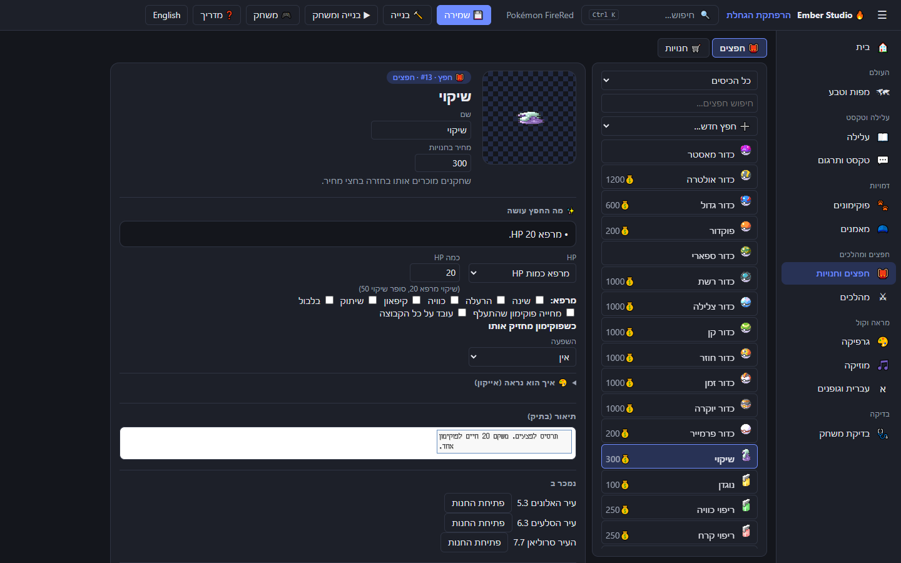

התצוגה **חנויות** מציגה את כל החנויות במשחק: כל דלפק של פוקה-מרט וכל חנות מיוחדת. בוחרים חנות כדי לשנות מה היא מוכרת, להוסיף או להסיר חפצים, ולשנות את הסדר.

אפשר גם ליצור חנות חדשה בכל מקום, עם הבלוק **🛒 לפתוח חנות**.

# מהלכים

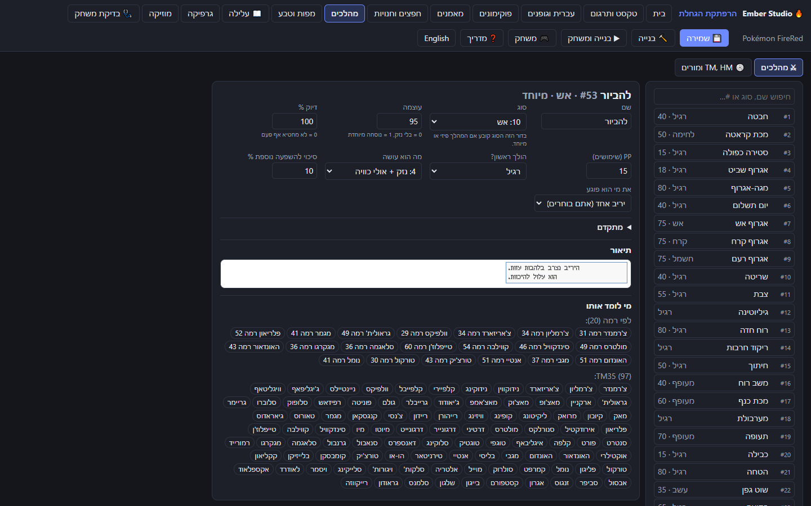

לכל מהלך:

- **שם** ו**תיאור**.
- **סוג**, **עוצמה**, **דיוק** ו-**PP**.
- **קטגוריה**: פיזי או מיוחד. כמו ב-FireRed, הסוג קובע אותה.
- **אפקט** והסיכוי שלו, ו**עדיפות**.

## TM, HM ומורים

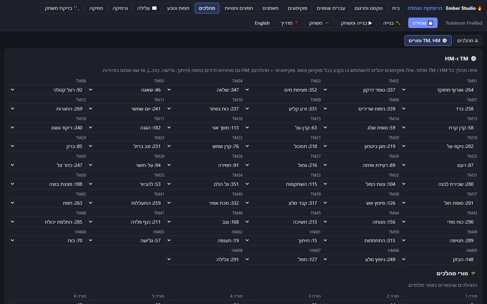

- **TM ו-HM**: איזה מהלך כל TM מלמד. השם והתיאור של ה-TM מתעדכנים לפי המהלך.
- **מורי מהלכים**: איזה מהלך מלמד כל מורה במשחק.

אילו פוקימונים יכולים ללמוד כל TM קובעים בלשונית *פוקימונים*.

# טקסט ותרגום

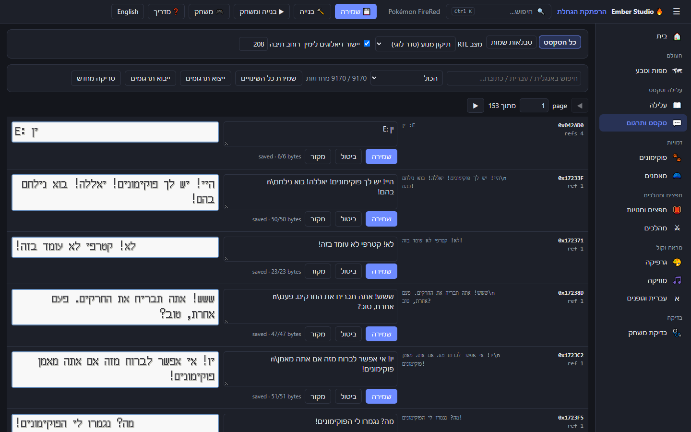

הלשונית **טקסט ותרגום** מציגה כל טקסט במשחק, יותר מ-9,000 מחרוזות: דיאלוגים, שלטים, תפריטים ושמות.

- **חיפוש** באנגלית (המקור) או בתרגום שלכם.
- **סינון** כדי להציג רק שורות שלא תורגמו, שתורגמו או ששונו.
- **מקלידים את הטקסט החדש** בתיבה. התצוגה המקדימה משמאל מראה בדיוק איך הוא ייראה בתיבת ההודעות של המשחק, שורה אחרי שורה.
- **שמירה** של כל שורה, או **שמירת כל השינויים** בבת אחת.
- **ייצוא תרגומים** ו**ייבוא תרגומים** מעבירים את כל הטקסט אל קובץ וממנו, כדי לתרגם בתוכנה אחרת או עם חברים.

## התרגום לעברית שמגיע עם העורך

Ember Studio מגיעה עם תרגום מלא של FireRed לעברית (יותר מ-7,000 שורות). אין בו את הטקסט האנגלי המקורי, שהוא של נינטנדו. לכל שורה נשמרת רק "טביעת אצבע" קצרה (hash) של השורה באנגלית, ו-Ember Studio משווה אותה לטקסט שב-ROM שלכם. שורה שלא מתאימה ל-ROM שלכם מדולגת.

## רוחב שורה

שורה רחבה מדי לתיבת ההודעות מסומנת באדום. מפצלים אותה לשורה חדשה או מקצרים. גם *בדיקת המשחק* מוצאת שורות כאלה.

# עברית וגופנים

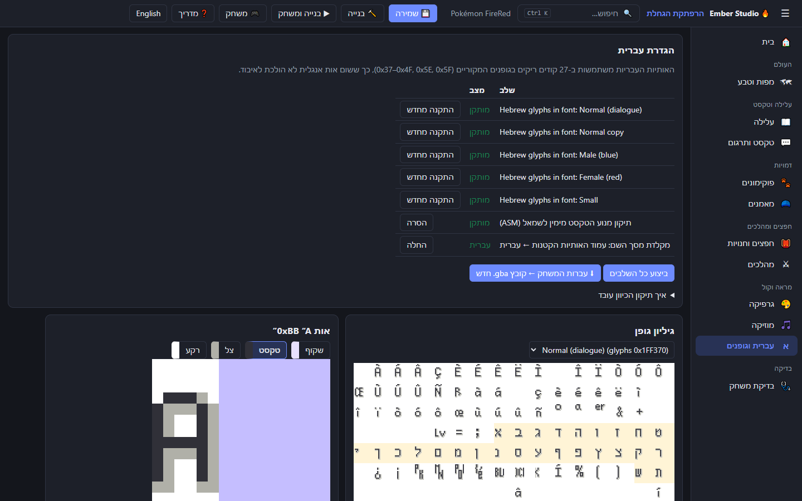

כששפת המשחק היא עברית, ‏Ember Studio:

- מוסיפה **אותיות עבריות** לגופן של המשחק;
- מתקנת את המשחק כך שיכתוב **מימין לשמאל**, גם בשורות מעורבות עם מספרים ושמות באנגלית;
- יכולה להחיל **תרגום מלא לעברית** של המשחק המקורי, שאותו אפשר לשנות.

**גיליון הגופן** מציג את כל האותיות. אפשר לצייר מחדש כל אות, פיקסל אחרי פיקסל, למשל כדי שהאותיות העבריות יתאימו לסגנון שלכם.

# גרפיקה

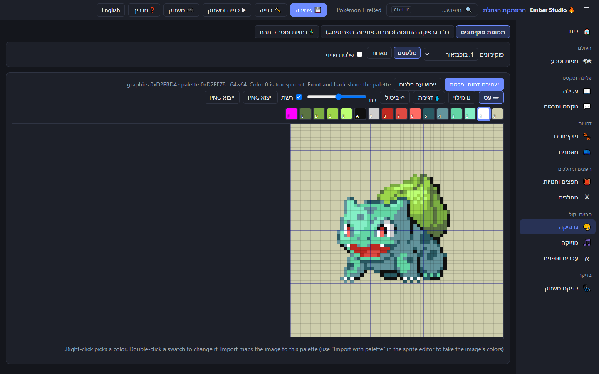

ללשונית **גרפיקה** יש שלושה חלקים:

- **תמונות פוקימונים**: תמונות מלפנים ומאחור, צבעים ואייקונים של כל פוקימון.
- **כל הגרפיקה הדחוסה**: כותרת, פתיחה, תפריטים ועוד. כל מה שדחוס ב-ROM.
- **🧍 דמויות ומסך כותרת**: מפורט בהמשך.

## דמות מתמונה

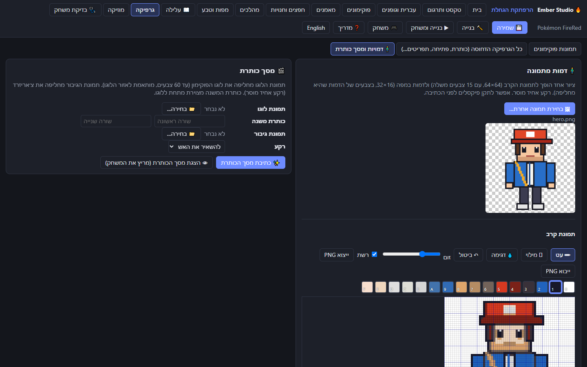

אפשר ליצור דמות חדשה, למשל גיבור חדש, מתמונה אחת:

1. לוחצים על **בחירת תמונה…** ובוחרים תמונה כלשהי עם רקע שקוף (PNG או WebP).
2. ‏Ember Studio יוצרת את **תמונת הקרב** (64×64, עד 15 צבעים ועוד שקיפות) ואת **הדמות במפה** (16×32), בצבעים של הדמות שהיא מחליפה.
3. בוחרים איזו דמות להחליף, ואם רוצים מתקנים פיקסלים בודדים: בעורך יש עט, מילוי, דגימת צבע וביטול.
4. כותבים למשחק.

## מסך הכותרת

תחת **🎬 מסך כותרת**:

- **תמונת לוגו**: מחליפה את לוגו הפוקימון (עד 60 צבעים, מותאמת לאזור הלוגו).
- **כותרת משנה**: שורה אחת או שתיים מתחת ללוגו.
- **תמונת גיבור**: דמות גדולה במסך הכותרת.
- **רקע**: להשאיר את המקורי, או רקע חדש.

לוחצים על **✨ כתיבת מסך הכותרת**. **👁 הצגת מסך הכותרת (מריץ את המשחק)** מריץ את המשחק ברקע ומראה את התוצאה.

# מוזיקה

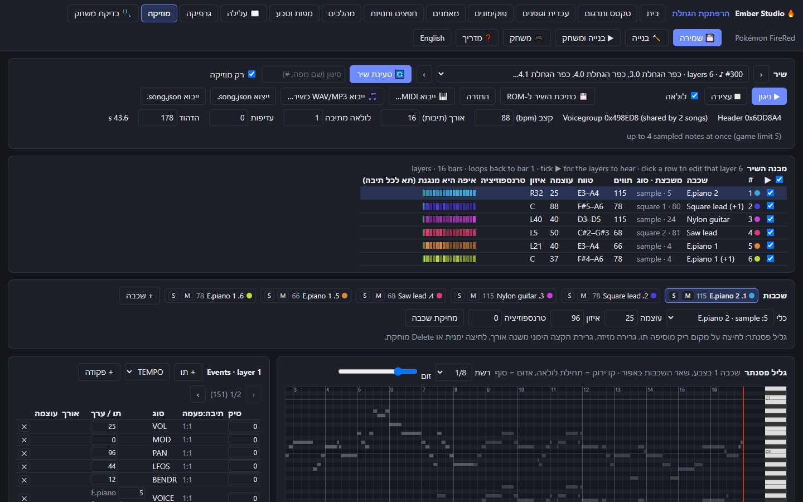

- **איזה שיר מתנגן איפה**: לכל מפה, סוג קרב ואירוע.
- **האזנה** לכל שיר במשחק, בתוך העורך.
- **ייבוא מוזיקה**: **🎹 ייבוא MIDI…** או **🎵 ייבוא WAV/MP3 כשיר…**. השיר נכתב לשטח פנוי במשחק, ואתם בוחרים איפה הוא מתנגן.

# בדיקת משחק

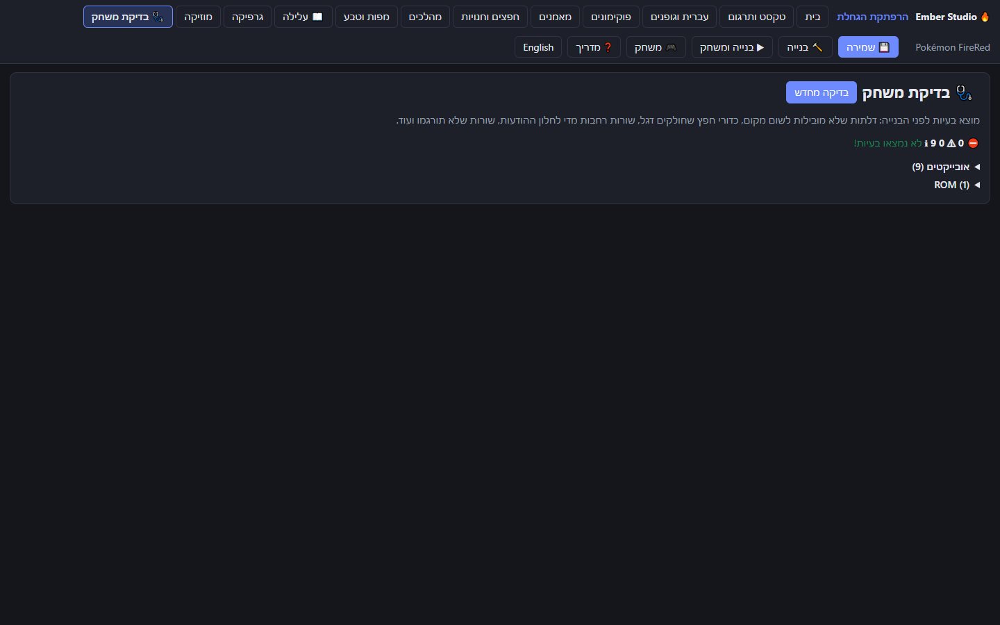

לפני ששולחים את המשחק, פותחים את **🩺 בדיקת משחק**. היא עוברת על כל המשחק ומציגה בעיות לפי קטגוריה:

| בעיה | למה זה חשוב |
|---|---|
| מפה שאי אפשר לטעון | המשחק יקרוס שם. |
| דלת שמובילה למפה שלא קיימת, או למספר דלת שאין במפה | השחקן נתקע או שהמשחק קורס. |
| אובייקט מחוץ למפה | לפעמים בכוונה (דמות שנכנסת בזמן סצנה), ולכן זו רק הערה. |
| כדור חפץ בלי דגל, או שני כדורים עם אותו דגל | החפץ חוזר כל פעם, או שאיסוף אחד מעלים את השני. |
| אותו מאמן בשימוש פעמיים | ניצחון על אחד נחשב לשניהם. |
| שורה רחבה מדי לתיבת ההודעות | הטקסט נחתך. |
| שורה שעדיין באנגלית (במשחק בעברית) | משהו נשאר בלי תרגום. |
| מנהיג מכון חלש מהמנהיג שלפניו | הקושי הולך אחורה. |
| כמעט לא נשאר מקום פנוי ב-ROM | סקריפטים ותמונות חדשים אולי לא ייכנסו. |

לכל בעיה יש כפתור **הצגה** שמעביר אתכם למקום הנכון. אחרי התיקונים לוחצים על **בדיקה מחדש**.

# בדיקה ומשחק


ב-Ember Studio מובנה האמולטור **mGBA**, והוא נפתח בחלון בתוך העורך.

## דרכים לשחק

| כפתור | איפה המשחק מתחיל |
|---|---|
| **🎮 משחק** | מההתחלה, כמו שהמשחק עכשיו. |
| **▶ בנייה ומשחק** | בונה את `out/game.gba` ואז משחק בו מההתחלה. |
| **▶ שחק מכאן** (עורך מפה או תצוגת עולם) | במקום שלוחצים עליו, עם קבוצת בדיקה. |
| **▶ בדיקה מהצעד הזה** (עלילה) | ממש לפני הצעד הזה בעלילה, כששלב העלילה מוגדר. |

## מקשים

| מקלדת | GBA |
|---|---|
| חיצים | כפתורי הכיוון |
| <kbd>X</kbd> | A |
| <kbd>Z</kbd> | B |
| <kbd>Enter</kbd> | Start |
| <kbd>Backspace</kbd> | Select |
| <kbd>A</kbd> / <kbd>S</kbd> | L / R |

קודם לוחצים על תמונת המשחק, כדי שהיא תקבל את המקשים.

## חלון האמולטור

- **⏸** משהה וממשיך.
- **×1 / ×2 / ×4 ⏩** הוא הילוך מהיר. מצוין להליכה למרחקים ארוכים או לדילוג על הפתיחה.
- **🔊** מפעיל או מכבה את הצליל.
- **💾 / 📂** שומרים וטוענים מצב: תמונה של רגע מדויק במשחק.
- **↻** מתחיל מחדש.
- **✕** סוגר.

## קבוצת הבדיקה

**▶ שחק מכאן** ו**בדיקה מהצעד הזה** נותנים לשחקן קבוצת בדיקה, כדי שאפשר יהיה להילחם מיד. משנים אותה בכפתור **🎒**: בוחרים פוקימונים ורמות.

> **טיפ:** הבדיקה משנה רק עותק של המשחק בזיכרון. הפרויקט שלכם לא משתנה.

# פרויקטים ושיתוף

## מה יש בתיקיית פרויקט

```
המשחק שלי/
  project.json        שם, שפה, ה-ROM הבסיסי, שלבי בנייה
  rom/patch.bin       השינויים שלכם ל-ROM (קטן)
  data/*.json         העלילה, הסקריפטים, קבוצת הבדיקה, שינויי פוקימונים, הזזות מפות (קריא)
  out/game.gba        המשחק הבנוי (לא נשמר ב-Git)
  README.md, .gitignore
```

- בפרויקט **אף פעם אין את ה-ROM המקורי**. כשפותחים פרויקט במחשב אחר, ‏Ember Studio מבקשת פעם אחת את ה-ROM של FireRed שלכם ובודקת שהוא הנכון.
- כל מה שמחוץ ל-`out/` קטן וקריא, ולכן מתאים מאוד ל-**Git**: רואים מה השתנה, ואפשר לחזור לכל גרסה.

## שימוש ב-Git

```
cd "My Game"
git init
git add .
git commit -m "First version"
```

קובץ ה-`.gitignore` ש-Ember Studio יוצרת כבר משאיר בחוץ את `out/` ואת קובצי השמירה. אפשר להעלות את הפרויקט ל-GitHub ולעבוד עליו עם חברים. כל אחד צריך ROM משלו.

## שיתוף המשחק

אסור לשתף את ה-ROM עצמו (`out/game.gba`), כי הוא מכיל את המשחק של נינטנדו. במקום זה משתפים אחד מאלה:

- **את תיקיית הפרויקט** (או את מאגר ה-Git שלה). אחרים פותחים אותה ב-Ember Studio עם ה-ROM שלהם.
- **טלאי (patch)** שהופך את FireRed המקורי למשחק שלכם. יוצרים אותו מה-ROM המקורי ומ-`out/game.gba` בכלי חינמי כמו *Floating IPS (Flips)*, והשחקנים מחילים אותו על ה-ROM שלהם באותו כלי. (כשעורכים קובץ ROM ישירות, בלי פרויקט, הכפתור **קובץ IPS** בסרגל העליון יוצר את הטלאי בשבילכם.)

## הפיכת ROM קיים לפרויקט

**📥 הפיכת ROM לפרויקט** לוקח האק או תרגום גמורים ויוצר מהם פרויקט:

1. בוחרים את קובץ ה-`.gba`.
2. בוחרים את FireRed (US) v1.1 המקורי.
3. ‏Ember Studio שומרת את ההבדל כ-`rom/patch.bin`.

מכאן עובדים עליו כמו על כל פרויקט אחר.

## שלבי בנייה (למתקדמים)

פרויקט יכול להריץ **שלבי בנייה** משלו: סקריפטים של Python שרצים בזמן הבנייה ומשנים את המשחק עוד. משחק הדוגמה *כחול-לבן* משתמש בשלב כזה למסך הכותרת ולגרפיקה. השלבים רשומים ב-`project.json`. ‏Ember Studio מריצה אותם רק כשהקבצים שלהם משתנים, כך שהבנייה נשארת מהירה.

# פתרון בעיות

**Windows אומרת שהיישום לא מוכר.**
לוחצים *מידע נוסף ← הפעל בכל זאת*. ראו *התקנה*.

**"זה לא FireRed (US) v1.1".**
‏Ember Studio עובדת רק עם הגרסה הזאת: קוד משחק BPRE, גרסה 1. בגרסאות אחרות (v1.0, אירופית, יפנית) הנתונים נמצאים במקומות אחרים.

**חלון האמולטור נשאר שחור.**
מחכים כמה שניות: בהפעלה הראשונה האמולטור מועתק. אם הוא נשאר שחור, סוגרים את החלון ב-✕ ולוחצים שוב על משחק.

**▶ שחק מכאן לא עושה כלום.**
בתצוגת עולם קודם לוחצים על מפה כדי לבחור אותה. הכפתור אפור עד שבוחרים מפה.

**שיניתי את העלילה, ושום דבר לא השתנה במשחק.**
אחרי שינוי צעדים לוחצים על **✨ הכנסת העלילה למשחק**, ואז בודקים שוב.

**המשחק קורס כשנכנסים לדלת.**
מריצים **🩺 בדיקת משחק**. היא מוצאת דלתות שלא מובילות לשום מקום.

**הטקסט נחתך.**
השורה רחבה מדי. מפצלים אותה לשתי שורות. לשונית הטקסט מסמנת שורות רחבות מדי באדום.

**אני רוצה לבטל הכול.**
אם אתם עובדים עם Git, חוזרים ל-commit ישן. אם לא, הקובץ `rom/patch.bin` שבפרויקט הוא העבודה שלכם: כדאי לשמור מדי פעם עותקים של התיקייה.

**איפה ההגדרות שלי?**
ב-`%LOCALAPPDATA%\EmberStudio`. מחיקת התיקייה הזאת מאפסת את Ember Studio. הפרויקטים לא נמצאים שם, אז הם בטוחים.

# רישיונות ותודות

- **Ember Studio** היא תוכנה חופשית תחת **GNU General Public License v3.0** ‏(GPL-3.0). מותר להשתמש בה, לשנות אותה ולשתף אותה. מי שמשתף גרסה משונה של התוכנה צריך לשתף גם את קוד המקור שלה.
- **המשחקים שאתם יוצרים** עם Ember Studio שייכים לכם. ה-GPL חל על העורך, לא על המשחק שלכם. פוקימון ו-FireRed שייכים ל-Nintendo, ל-Game Freak ול-The Pokémon Company. משתפים טלאים או פרויקטים, לא קובצי ROM.
- **mGBA** (האמולטור המובנה) נכתב על ידי Vicki Pfau ותורמים נוספים, תחת Mozilla Public License 2.0. גרסת ה-WebAssembly היא של thenick775.
- **pywebview**, ‏**Pillow** ו-**PyInstaller** משמשים לפי הרישיונות שלהם.

המדריך נוצר מתוך התוכנה עצמה: כל התמונות צולמו אוטומטית מ-Ember Studio. תיקונים ותרגומים יתקבלו בשמחה ב-GitHub.
